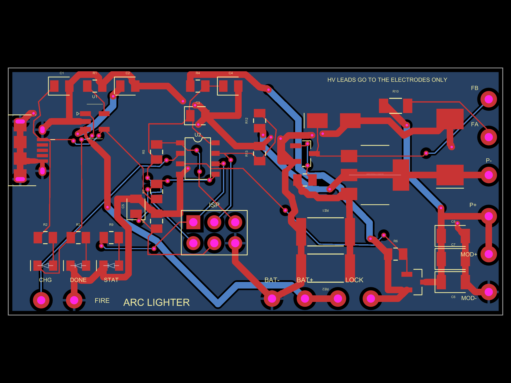
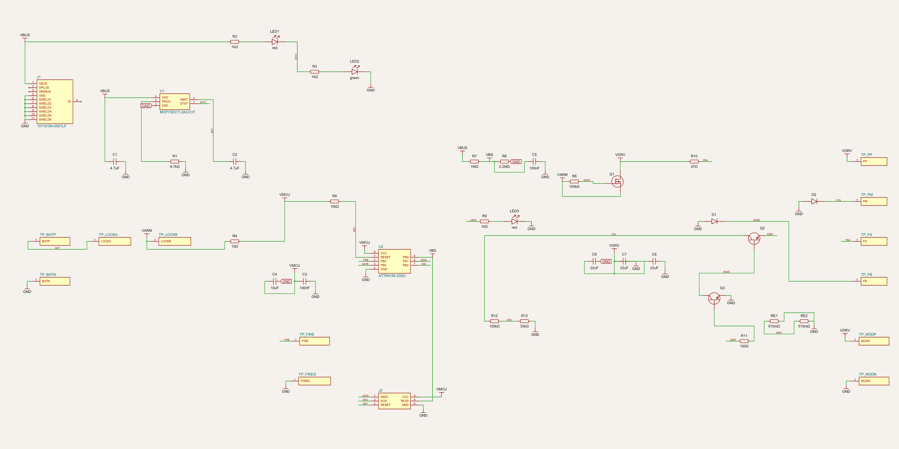

# Arc Lighter — build a rechargeable electric arc lighter, and understand every part of it

A USB-rechargeable lighter that makes a continuous electric arc between two
electrodes instead of a flame — hot enough to light paper, a candle wick or
a cigarette, with no fuel and nothing to blow out. Designed in
[tscircuit](https://tscircuit.com), simulated from the routed board, with
firmware you build and program yourself.

```
micro-USB ─► MCP73831 charger ─► protected LiPo ─► LOCK ─► ATtiny85 (safety brain)
                                                     │            │ gate
                                                     └─► Q1 power switch ─► FZT851 driver ─► coil ─► ~7-15 kV arc
```

> **⚠ Read §1 (Safety) before you build anything.** This project makes
> several thousand volts and stores energy in a lithium cell. Treated with
> respect it is a fun, safe build; treated casually it burns skin, starts
> fires and can be lethal for anyone with a pacemaker.

## Contents

- [Start here: the whole lighter explained simply](#start-here-the-whole-lighter-explained-simply)
- [Words you'll meet](#words-youll-meet)
0. [What's in this folder](#0-whats-in-this-folder)
1. [Safety](#1-safety)
2. [How an arc lighter works](#2-how-an-arc-lighter-works)
3. [The circuit, block by block](#3-the-circuit-block-by-block)
4. [The firmware](#4-the-firmware)
5. [Bill of materials](#5-bill-of-materials)
6. [Making the board](#6-making-the-board)
7. [Programming the ATtiny85](#7-programming-the-attiny85)
8. [Bring-up: first power, first arc](#8-bring-up-first-power-first-arc)
9. [Using it](#9-using-it)
10. [Troubleshooting](#10-troubleshooting)
11. [How the design was verified](#11-how-the-design-was-verified)
12. [Design notes: what the simulations taught us](#12-design-notes-what-the-simulations-taught-us)

---

## Start here: the whole lighter explained simply

If you've never studied electronics, read this part first. Everything
after it explains the same story again, with the real numbers.

### Electricity is like water in pipes

| Electricity | Water picture |
|---|---|
| **Voltage** (volts, V) — how hard electricity is pushed | water **pressure** |
| **Current** (amps, A) — how much flows | how much **water flows** each second |
| **Battery** | a **water tank** with a pump that keeps a steady pressure (3.7 V) |
| **Resistor** | a **narrow pipe** |
| **Capacitor** | a small **bucket** right next to where water is needed, for quick gulps |
| **Diode** | a **one-way valve** |
| **Transistor / MOSFET** | a **tap** that a small signal can open and close, very fast |

### What we want: a tiny lightning bolt

Air doesn't let electricity through — it's like a wall. But push hard
enough and the wall breaks: at a few **thousand** volts per millimetre,
the air between two metal tips suddenly turns into a glowing, very hot
path (**plasma**). That's what lightning is. Our arc is a tiny,
continuous lightning bolt between two tips 4-5 mm apart, hot enough to
light paper in a moment.

### The problem: the battery only pushes 3.7 V

We need about **10 000 V**. The battery gives 3.7 V. How?

**Trick 1 — current doesn't like to stop.** Current flowing through a
coil of wire (an **inductor**) is like water flowing through a long,
heavy hose: it has "momentum". Shut the tap suddenly and the water bangs
against it with a huge pressure spike (that's the "thud" you sometimes
hear in house pipes — *water hammer*). A coil does the same: stop its
current suddenly and it makes a huge voltage spike.

**Trick 2 — a transformer multiplies it.** Our coil is really two coils
on the same core: a **primary** with a few turns of thick wire, and a
**secondary** with thousands of turns of hair-thin wire. Whatever
happens in the primary appears in the secondary multiplied by the turns
ratio, about 400×. The primary's spike becomes thousands of volts at the
tips — the air breaks — **an arc**.

**Trick 3 — do it 5 000 to 16 000 times a second.** Each spike is one
tiny spark; tens of thousands a second look like one steady arc.

### Who opens and closes the tap so fast? The coil itself

The tap is a transistor, **Q2**. The coil has a third, small winding
that tells Q2 what to do: while current is building up, it pushes Q2's
"open" input; when the coil is full, the push reverses and slams Q2
shut — spike! — then the cycle restarts by itself. It's like pushing a
child on a swing: the swing itself tells you when to push. This is
called a **blocking oscillator**.

Because a modern transistor is so strong, it might keep the tap open too
long and let the current run away. So a second, small transistor (**Q3**)
watches the current through two small resistors (**RE1, RE2**) and
closes the tap at 2.6 A every single cycle — a governor.

### The brain: a careful supervisor

A tiny computer, the **ATtiny85**, sits between you and all that. It
only lets the arc run:

- while you **hold** the FIRE button — and at most **8 seconds** at a time;
- if the lighter is **not plugged into USB**;
- if the battery is **not too low**;
- if the coil is **really ringing**: it counts the spikes, and if there
  are too few (a broken or wrongly wired coil), it stops within 40 ms.

It switches the arc's power with **Q1**, another tap, and blinks an LED
to tell you why it stopped. And above everything there is the **LOCK**
slide switch: when it's off, nothing but the charger is connected to the
battery at all.

### The charger: refilling the tank carefully

Lithium batteries are powerful and must be filled gently: never above
4.20 V, at a sensible rate. A dedicated charger chip (**MCP73831**) does
exactly that from a USB cable, and lights red while charging, green when
full.

### What happens, moment by moment, when you press FIRE

| Time | What happens |
|---|---|
| 0 ms | You press FIRE (lighter unlocked). The sleeping chip wakes up. |
| 30 ms | The button is still pressed (it wasn't a bounce): checks pass — battery OK, no USB. The chip opens Q1: power reaches the coil. |
| 30.1 ms | Q2's tap opens; current builds up in the coil's primary and reaches 2.6 A within 20-100 µs (millionths of a second); Q3 closes the tap — spike — up to 10 000 V at the tips — **the air breaks: the arc strikes**. |
| then | the same, 5-16 thousand times a second. The chip counts the spikes, watches the battery and the clock. |
| you let go (or 8 s pass) | The chip closes Q1. Silence. It goes back to sleep, using almost nothing. |

---

## Words you'll meet

| Word | Meaning |
|---|---|
| **ADC** | the chip's voltmeter: turns a voltage into a number. Here it measures the battery (via the chip's built-in 1.1 V reference). |
| **Arc / plasma** | air turned conductive by a high voltage: a hot, glowing path for current. |
| **Breakdown** | the moment the air stops insulating. |
| **Collector, base, emitter** | the three legs of an NPN transistor: a small current into the **base** lets a big current flow from **collector** to **emitter**. |
| **Current limit** | Q3 + RE1/RE2: ends every cycle at ≈ 2.6 A, whatever the coil. |
| **Debounce** | ignoring the few milliseconds of on-off chatter a mechanical button makes when pressed. |
| **Feedback winding** | the coil's small third winding that drives Q2's base. Wired backwards, nothing oscillates (swap FA/FB). |
| **Firmware** | the program inside the chip. |
| **Flyback** | the voltage spike when a coil's current is suddenly stopped. |
| **Footprint** | the copper pads on the board a part is soldered to. |
| **Fuses (AVR)** | a few configuration bytes set once per chip (clock, brown-out level). Nothing to do with a blowing fuse. |
| **Gate** | the control pin of a MOSFET. |
| **High-side switch** | a tap in the + wire (Q1), rather than the − wire. |
| **Inductor / coil** | wire wound in turns; stores energy in its magnetic field and resists sudden changes of current. |
| **ISP** | in-system programming: loading firmware through 6 pins (J2). |
| **LiPo, protection board** | the lithium-polymer cell; the little circuit under its tape that cuts it off on a short, over-charge or over-discharge. |
| **MOSFET (P-channel)** | Q1: a tap that opens when its gate is pulled *below* its source. |
| **Primary / secondary / turns ratio** | the transformer's input winding (few turns), output winding (thousands of turns), and the ratio between them (≈ 1 : 400). |
| **Pull-up / pull-down** | a resistor that gently holds a pin high or low when nothing drives it. R6 holds Q1 **off** by default. |
| **Schottky diode** | a fast diode that wastes little voltage (D1). |
| **SMD, 0805, SOT-23, SOT-223, SMC** | surface-mount parts and their package sizes (0805 = 2.0 × 1.25 mm). |
| **Sleep (power-down)** | the chip stops its clock and waits for the button, using a few millionths of an amp. |
| **T0 counter** | a hardware counter inside the chip that counts the coil's spikes on PB2 by itself. |
| **TVS diode** | D2: a diode built to absorb voltage spikes — it clamps Q2's collector at ≈ 40 V. |
| **VARM, VDRV, VMCU** | the board's names for: battery after LOCK, coil supply after Q1, the chip's filtered supply. |

---

## 0. What's in this folder

```
arc-lighter/
├── board/index.tsx          ← the PCB: parts, connections, placement, the hand-routed power loop
├── lib/parts.tsx            ← footprints written from datasheets (pin-mapped), courtyards, fab rules
├── lib/usb-micro-b.tsx      ← Amphenol 10118194 micro-USB footprint (same as unode-32u4)
├── firmware/arc_lighter/    ← C firmware for the ATtiny85: main.c (hardware) + lighter.c (logic)
│   ├── Makefile             ← avr-gcc / avrdude build, flash and fuse targets
│   └── platformio.ini       ← the same with PlatformIO
├── firmware/test/           ← unit tests that run the firmware's logic on your computer
├── calc/circuit_math.mjs    ← every design equation, asserted (28 checks)
├── calc/sim_driver.mjs      ← simulates the routed board's driver with many coils (14 checks)
├── calc/spice.mjs           ← the circuit simulator (MNA + Newton, transistor/diode models,
│                               coupled inductors, spark gap)
├── calc/board_to_spice.mjs  ← routed board → SPICE deck converter
├── calc/spice/arc-driver.cir← the generated deck
├── verify.mjs               ← board audit: DRC, parts, topology, values, 0.8 mm power loop, fab rules
├── render.mjs               ← PCB + schematic images
└── render-pcb.png / render-schematic.png
```

Quick start (needs [Node.js](https://nodejs.org) or [Bun](https://bun.sh), and `npm install -g tscircuit`):

```bash
cd arc-lighter
npm install
npm run dev            # the board in your browser: PCB, schematic, 3D
npm run build          # compile the board (verify, sim and render import it)
npm run verify         # board audit
npm run math           # design equations
npm run sim            # driver simulation (~1.5 min)
npm run test:firmware  # firmware logic tests (needs any C compiler)
```




---

## 1. Safety

**High voltage.** The coil's output is several thousand volts (7-15 kV).
The current is small, but a shock still hurts badly, causes a burn at the
contact point and makes muscles jerk — easy to drop a soldering iron or
knock something over. It can be **dangerous for people with pacemakers or
heart conditions**. Rules:

- Never touch the electrodes or the coil's thin output leads while the
  lighter is UNLOCKED. Lock it (slide switch) before touching anything.
- The high-voltage leads go **only** to the electrodes — never to the PCB,
  never near the battery. Keep at least 10 mm of air or solid insulation
  between them and everything else.
- Work on it unplugged and locked. The bulk capacitors hold no dangerous
  charge, but the coil can give a nip if you touch it while it rings down.

**Fire.** The arc is a heat source — that is the point. Don't fire it near
fuel, solvents, aerosol sprays, dry paper you don't intend to light, or
inside a closed pocket. The firmware stops the arc after 8 seconds and the
lock stops it completely; still, treat it like any lighter: lock it, and
keep it away from children.

**The lithium cell.** A LiPo short-circuited or overcharged can burn
violently. Rules:

- Use only a **protected** single-cell LiPo (a pack with a small protection
  board under its tape — almost all hobby packs have one). The protection
  board is the last line of defence against shorts and over-discharge.
- Get the polarity right: red wire to **BAT+**, black to **BAT−**. Check it
  with a multimeter before soldering.
- Don't crush, puncture or overheat it; don't leave it charging unattended
  the first few times; stop using a pack that swells.

**Legal.** Electric (arc/plasma) lighters are ordinary consumer products in
most countries, but some airlines and countries restrict lithium-powered
lighters in luggage. Check before you fly.

---

## 2. How an arc lighter works

### 2.1 Air is an insulator — until it isn't

Dry air between two electrodes blocks current, up to a point: at roughly
1-3 kV per millimetre (less for pointed electrodes) the air *breaks down*.
A few free electrons accelerate hard enough to knock electrons off air
molecules, those do the same, and in nanoseconds the gap fills with ionised
gas — plasma — that conducts well. The voltage across the gap collapses to
a few hundred volts and current flows: an **arc**. The arc is a few
thousand °C hot, which is why it lights paper instantly.

So we need two things: **several kilovolts** to break the gap down, and
then **a steady supply of energy** to keep re-striking it thousands of
times a second, so it looks continuous.

### 2.2 Getting kilovolts from a 3.7 V cell: the flyback trick

A transformer multiplies voltage by its turns ratio. The coil has a
**primary** of a few turns of thick wire and a **secondary** of thousands
of turns of hair-thin wire — a step-up of roughly 1 : 250-600.

But a transformer only works with *changing* current, and the trick here
is to change it suddenly:

1. **Charge:** the transistor Q2 switches the primary across the battery.
   Current ramps up (V = L · dI/dt) and energy builds up in the coil's
   magnetic field: E = ½ · L · I². With 100 µH and 2.6 A that's about
   0.34 mJ.
2. **Fly back:** Q2 switches off. The magnetic field can't vanish
   instantly, so it forces the current somewhere — the only path is the
   secondary. The secondary voltage climbs until the gap breaks down; the
   stored energy pours into the arc.
3. **Repeat** 5 000-16 000 times a second (simulated, depending on the coil).

How high can the voltage get? Every secondary winding has a little
self-capacitance (a few pF). The stored energy has to charge it to the
breakdown voltage: ½ · L · I² > ½ · C · V². With 100 µH, 2.6 A and 6 pF
that gives up to ≈ 10 kV — enough for a 4-5 mm gap. **This is why the
current limit can't be too low** (§12).

### 2.3 The self-oscillating driver ("blocking oscillator")

Who switches Q2 on and off? The coil itself. Lighter coils have a third
winding — the **feedback** winding — that sits on the same core:

- While Q2 is on, the primary current rises, and the feedback winding
  produces a voltage that *adds* to Q2's base drive: Q2 is held hard on.
- When the current stops rising, the feedback voltage collapses, Q2 starts
  to turn off, which makes the feedback reverse and slam it fully off.
- Once the energy has flown into the arc, the feedback swings back and the
  cycle restarts by itself.

Wired the wrong way round, the feedback *fights* the drive and nothing
oscillates — which is why you may have to swap the two feedback wires
(FA/FB), and why the firmware watches for that (§4).

### 2.4 Why this board adds a current limit

A textbook blocking oscillator ends each cycle when the transistor runs
out of gain (current = gain × base current) or the coil's core saturates.
With a modern high-gain transistor and an unknown coil, neither is
reliable: in simulation the current ran away past 6 A. So Q3 and the two
emitter resistors **end every cycle at ≈ 2.6 A**, whatever the coil or the
transistor (§3.6).

---

## 3. The circuit, block by block

Open `board/index.tsx` alongside — every block below is a section there.

### 3.1 USB charging (J1, U1, C1, C2, R1, LED1-2)

The **MCP73831** is a complete lithium charger in a 5-pin package: it
charges at a constant current, then holds 4.20 V (±0.75 %) and stops when
the current tapers off. **R1 sets the current**: I = 1000 V / R1 =
1000 / 4 700 ≈ **213 mA**, gentle for a 300-500 mAh cell (≈ 1.5-3 h for a
full charge). Its STAT pin is LOW while charging (red LED1 lights from
VBUS) and HIGH when done (green LED2 lights to ground).

The charger connects to the cell **before** the LOCK switch, so the lighter
charges while locked. The micro-USB data lines are unused.

### 3.2 Battery and LOCK (BAT±, LOCK pads)

The cell's protection board cuts it off at ≈ 4.3 V (over-charge), ≈ 2.4 V
(over-discharge), ≈ 3 A (over-current) and on a short. LOCK is a slide
switch between the LOCKA and LOCKB pads. Everything except the charger sits
behind it (the **VARM** net), so a locked lighter can't arc even if the
firmware misbehaved, and draws nothing at all.

### 3.3 The brain: ATtiny85 (U2) and its supply

An ATtiny85 — 8 pins, 8 KB of flash — makes every decision. It's powered
from VARM through **R4 (10 Ω) and C4 (10 µF)**: the coil pulls 2 A pulses
from the cell, and this little filter keeps the resulting voltage ripple
22 dB away from the microcontroller.

| Pin | Job |
|---|---|
| PB3 | FIRE button (to ground; internal pull-up; wakes the chip from sleep) |
| PB4 | Q1's gate: LOW = arc power on. R6 (100 kΩ) holds it HIGH = off whenever the chip is in reset, asleep or being programmed |
| PB2 | coil pulse counter — the chip's hardware counter input T0 counts every flyback, no CPU time needed |
| PB0 | USB sense (R7/R8): firing is refused while USB is plugged in |
| PB1 | status LED (blink codes) |
| — | the cell voltage is read with no pin: the ADC measures its internal 1.1 V reference against VCC |

**J2** is the standard 6-pin AVR ISP header for programming.

### 3.4 The power switch: Q1 (AO3401A)

A P-channel MOSFET between VARM and the driver (VDRV). Pulling its gate low
turns it on (≤ 0.08 Ω); R6 pulls it off by default. A *high-side* switch
leaves the driver's ground solid and nothing live on the coil when idle.

### 3.5 The driver: Q2 (FZT851) and friends

- **Q2** switches the coil's primary (P+ to VDRV, P− to the collector).
  FZT851: 60 V, 6 A, gain ≥ 100 — in a SOT-223 whose big tab spreads heat.
- **R10 (47 Ω)** feeds base current through the feedback winding (FA, FB).
- **C6-C8 (3 × 22 µF)** supply the 2-3 A current pulses right next to the
  coil, so they don't have to come all the way from the cell.
- **D1 (SS14)** stops the reversed feedback from pulling the base below
  −0.4 V (the base-emitter junction breaks down at 6 V).
- **D2 (SMCJ33A, a TVS diode)** clamps the collector at ≈ 40 V. Every cycle
  the coil's "leakage" inductance (the bit of field that doesn't link the
  secondary) produces a spike; D2 absorbs it (simulated ≤ 2.7 W while
  arcing, so it's the large SMC package with its anode on the ground pour).
  If the arc can't strike, D2 holds Q2 well below its 60 V rating.

### 3.6 The current limit: Q3, R11, RE1 ∥ RE2

The emitter current flows through RE1 ∥ RE2 = 0.255 Ω. At 2.55 A they drop
0.65 V — enough to turn on Q3 through R11. Q3 then steals Q2's base current,
Q2 starts to come out of saturation, the feedback reverses and Q2 snaps off.
Result: **every cycle ends at ≈ 2.6-3.3 A** (simulated), regardless of the
coil. Two 2512-size resistors share the ≈ 1.3 W.

### 3.7 The oscillation monitor: R12, R13

R12/R13 (100 k / 33 k) scale the collector's 0-40 V flyback pulses down to
logic level for PB2. Any flyback above ≈ 10 V counts — even a high-ratio
coil's ≈ 15 V flyback. The firmware expects ≥ 2 kHz of pulses; a working
coil gives 7.5-16.5 kHz (simulated), a stalled one gives zero.

### 3.8 The PCB layout

- **The current loop is hand-routed** with 0.8 mm copper: BAT+ → LOCK → Q1
  → C6-C8 → coil … coil → Q2 → RE1/RE2 → BAT−. An autorouter will happily
  connect a net through a 0.15 mm trace — fine for a signal, a fuse for 2 A.
- **The bottom layer is a solid ground pour**: the return path for every
  current, and a heat spreader for D2, Q2 and the emitter resistors.
- **No high voltage on the PCB.** The coil's output leads go straight to
  the electrodes.
- Footprints are written from the datasheets with each pad mapped to the
  right pin (§12), every part has a courtyard, and the board meets standard
  fab rules (0.15 mm traces/clearances, 0.3/0.6 mm vias).

---

## 4. The firmware

`firmware/arc_lighter/` — plain C for avr-gcc, about 250 lines.

- `lighter.c` / `lighter.h` — **all the decisions**, with no hardware in
  them. Every 10 ms `main.c` hands it the inputs (button, USB, cell voltage,
  coil pulses counted) and gets back "fire / LED / may sleep".
- `main.c` — the hardware: timers, ADC, pins, sleep.

The rules while firing, in order:

| Condition | Action | LED |
|---|---|---|
| FIRE released | stop | — |
| USB plugged in | stop | 2 blinks |
| fewer than 40 coil pulses in a 20 ms window (< 2 kHz) | stop within ≈ 40 ms | 4 blinks — "swap FA/FB" |
| cell below 3.00 V for 200 ms | stop | 3 blinks |
| 8 s of continuous arc | stop; refuse for 5 s | 1 blink |

And before firing: refused if USB is connected, during the cooldown, or if
the cell is below 3.40 V at rest. After any stop other than a release, FIRE
must be **released and pressed again** — a held button never re-triggers,
not even after a reset. The button is debounced (30 ms). Idle, the chip is
in power-down sleep (≈ 0.1-25 µA) and wakes on the button.

`firmware/test/test_lighter.c` checks all of this on your computer (28
tests): `npm run test:firmware` (or `sh firmware/test/run.sh`).

---

## 5. Bill of materials

**On the board** (all SMD except J2; JLCPCB can assemble them):

| Ref | Part | Value / MPN | Notes |
|---|---|---|---|
| J1 | Micro-USB B receptacle | Amphenol **10118194-0001LF** | footprint is specific to this part |
| U1 | Li-ion charger | Microchip **MCP73831T-2ACI/OT** | SOT-23-5, 4.20 V |
| U2 | Microcontroller | Microchip **ATTINY85-20SU** | SOIC-8 |
| Q1 | P-MOSFET | AOS **AO3401A** | SOT-23 |
| Q2 | NPN power transistor | Diodes Inc. **FZT851TA** | SOT-223; alternative FZT853TA |
| Q3 | NPN small-signal | **BC847B** | SOT-23 |
| D1 | Schottky diode | **SS14** | SMA |
| D2 | TVS diode, 33 V standoff | **SMCJ33A** | SMC, unidirectional |
| RE1, RE2 | resistor | 0.51 Ω, 1 W | 2512 |
| R10 | resistor | 47 Ω | 1206 |
| R1 | resistor | 4.7 kΩ (charge current) | 0805 |
| R2, R3, R9 | resistor | 1 kΩ | 0805 |
| R4 | resistor | 10 Ω | 0805 |
| R5 | resistor | 10 kΩ | 0805 |
| R6, R12 | resistor | 100 kΩ | 0805 |
| R7 | resistor | 1 MΩ | 0805 |
| R8 | resistor | 2.2 MΩ | 0805 |
| R11 | resistor | 100 Ω | 0805 |
| R13 | resistor | 33 kΩ | 0805 |
| C1, C2 | ceramic capacitor | 4.7 µF, 10 V+ | 0805 X5R |
| C3, C5 | ceramic capacitor | 100 nF | 0805 |
| C4 | ceramic capacitor | 10 µF, 10 V+ | 0805 X5R |
| C6, C7, C8 | ceramic capacitor | 22 µF, 10 V+ | 1206 X5R |
| LED1 | LED red | 0805 | charging |
| LED2 | LED green | 0805 | charged |
| LED3 | LED red/orange | 0805 | status |
| J2 | 2 × 3 pin header, 2.54 mm | optional | only for programming |

**Off the board** (wired to the pads):

| Item | What to buy |
|---|---|
| Cell | 1-cell LiPo, 3.7 V, 300-600 mAh, **with protection board**, rated ≥ 3 A (e.g. "502535 with PCM", 15C packs) |
| HV coil | a "3.7 V arc lighter coil / booster coil" with **4 low-voltage leads** (primary + feedback) and 2 HV leads — e.g. Tianwang TW-G-DH-212 class, or the coil from any "3.7 V 15 kV arc igniter" kit |
| LOCK | small slide switch, ≥ 3 A (SS-12D00-style or a panel slide switch) |
| FIRE | momentary push button (any small tactile/panel button) |
| Electrodes | 2 × ≈ 1 mm tungsten (TIG electrode) or stainless-steel wire, ~25 mm long |
| Electrode holder | ceramic tube or PTFE/silicone block (the arc is hot: no PLA near it) |
| Wire | 24-26 AWG silicone wire for battery/switch/coil; the coil's own HV leads |
| Case | 3D-printed (PETG/ABS) or a recycled lighter shell, with the electrodes in a vented, open-ended tip |

---

## 6. Making the board

**Order it:** export the fabrication files and upload the zip to JLCPCB,
PCBWay or any 2-layer fab (1.6 mm FR-4, 1 oz copper, any colour):

```bash
tsci export -f gerbers board/index.tsx -o arc-lighter-gerbers.zip
```

The zip includes `bom.csv` and `pick_and_place.csv` for assembly; passive
parts already carry JLCPCB part numbers, the ICs/transistors/diodes need
you to pick the LCSC part for each MPN above. **Check the rotation of every
polarised part (U1, U2, Q1-Q3, D1, D2, LED1-3, J1) in the assembler's 3D
preview** — tscircuit can't confirm pick-and-place rotation for parts
without supplier pin-1 data, and a backwards TVS or transistor is the
classic first-board mistake.

**Or solder it yourself.** Everything is 0805 or larger, doable with a fine
tip, flux and tweezers; the SOT-23s and the micro-USB are the fiddly ones.
Order: micro-USB → ICs → transistors → diodes (bands!) → resistors →
capacitors → LEDs (the line on the silkscreen marks the cathode). Inspect
every joint with a magnifier; check for bridges on U2 and J1.

---

## 7. Programming the ATtiny85

**Toolchain:**

```bash
# macOS
brew tap osx-cross/avr && brew install avr-gcc avrdude
# Debian/Ubuntu
sudo apt install gcc-avr avr-libc avrdude
# or anywhere: pip install platformio   (then use platformio.ini)
```

**Programmer:** any AVR ISP: a USBasp, or an Arduino (Uno, Nano, or the
μNode32U4 from this repo) running the **ArduinoISP** example sketch.
Wire it to J2 (or straight to the chip's pins):

| J2 pin | Signal | Arduino as ISP |
|---|---|---|
| 1 | MISO | D12 (Uno) |
| 2 | VCC | 5 V |
| 3 | SCK | D13 |
| 4 | MOSI | D11 |
| 5 | RESET | D10 |
| 6 | GND | GND |

**Important:** program with the lighter **LOCKED** (slide switch off) and
the coil disconnected or the gap clear — the programmer powers the chip
through J2, and a locked lighter keeps that 5 V off the cell.

```bash
cd firmware/arc_lighter
make                                   # build (or: make MODULE=1 — see §8.6)
make fuses PORT=/dev/tty.usbmodem1101  # once per chip: brown-out reset at 2.7 V
make flash PORT=/dev/tty.usbmodem1101
# USBasp instead:  make flash PROGRAMMER=usbasp PORT=usb
```

Fuses: low 0x62 (factory 1 MHz), high 0xDD (brown-out 2.7 V), extended
0xFF.

---

## 8. Bring-up: first power, first arc

Go step by step; each step proves something before you add risk. You need
a multimeter; a bench power supply with a current limit makes it much
safer.

### 8.1 Before any power
- Check with the multimeter: no short between BAT+ and BAT−, VDRV (C6) and
  ground, USB VBUS and ground.
- Check the diode bands (D1, D2) and transistor orientation against the
  silkscreen.

### 8.2 Charger alone
Plug in USB with no cell: LED1/LED2 may glow faintly — normal. Connect the
cell: the red LED lights (charging) and turns green when full. Measure the
cell: it should creep toward 4.20 V.

### 8.3 Logic alone (no coil)
Program the chip (§7). Connect the cell, unlock. Measure VMCU ≈ cell
voltage. Press FIRE: with no coil the firmware sees no pulses and stops
within ≈ 40 ms — **LED3 blinks 4 times**. That proves the button, the gate
switch and the monitor's fault path all work.

### 8.4 Identify the coil's windings
With a multimeter on the ohms range, measure between every pair of the
coil's leads:

| Winding | Typical resistance | Wire |
|---|---|---|
| primary (→ P+, P−) | 0.05-0.3 Ω | the thickest |
| feedback (→ FA, FB) | 0.2-2 Ω | thinner |
| secondary (→ electrodes) | hundreds of Ω to a few kΩ | hair-thin, the two HV leads |

Solder the primary to P+/P−, the feedback to FA/FB (either way round for
now), and the HV leads to the electrodes. Set the electrode gap to
**3 mm** to start.

### 8.5 First arc
If you have a bench supply: set it to 3.8 V with a 2.5 A limit and feed it
to BAT+/BAT− instead of the cell. Unlock, press FIRE briefly:

- **Arc:** done — measure the current (≈ 1.4-2.1 A expected), then widen
  the gap to 4-5 mm until it stops striking reliably and back off 0.5 mm.
- **4 blinks, no arc:** the feedback is backwards — lock, swap FA and FB,
  try again.
- **Still nothing with both orientations:** check the primary isn't open
  and the windings were identified correctly.

### 8.6 Using a complete arc module instead
If you bought a potted "3.7 V 15 kV arc module" (coil + its own driver):
leave Q2, Q3, D1, D2, R10-R13, RE1, RE2 unfitted, wire the module's input to
MOD+/MOD−, and build the firmware with `make MODULE=1` (there's no collector
for the monitor to watch). Everything else — charging, lock, timeout,
lockouts — works the same.

---

## 9. Using it

1. **Slide LOCK on** (armed).
2. **Hold FIRE**: the arc runs while you hold it, up to 8 s.
3. **Release**, and **slide LOCK off** whenever you put it away.

**Charging:** plug micro-USB in — red = charging, green = full (≈ 1.5-3 h).
The lighter refuses to fire while plugged in.

**Status LED codes:**

| Blinks | Meaning | What to do |
|---|---|---|
| 1 | 8 s limit reached | release; wait 5 s |
| 2 | USB connected | unplug to use |
| 3 | cell low | charge it |
| 4 | coil not oscillating | coil/wiring fault (bring-up: swap FA/FB) |

A full 300 mAh cell gives ≈ 8 minutes of arc — roughly a hundred
5-second lights.

**Care:** the electrodes slowly erode and blacken; scrape them clean and
re-set the gap occasionally. Keep the tip free of ash and lint.

---

## 10. Troubleshooting

| Symptom | Likely cause | Check |
|---|---|---|
| Nothing at all, no LED | locked, flat cell, cell protection tripped | unlock; charge (a tripped protection resets when charged) |
| 3 blinks on a fresh charge | cell sags hard under load | old/small cell, thin wires, cold weather; use a ≥ 3 A rated pack |
| 4 blinks every time | feedback reversed, coil open, wrong windings | §8.4-8.5 |
| Weak, short arc | gap too wide; worn electrodes | close the gap to 3-4 mm, clean the tips |
| Arc then 3 blinks after a second or two | cell nearly empty | charge |
| Hisses/clicks but no visible arc | gap too wide; HV leaking to the case | shorten the gap; re-insulate the HV leads |
| Charger LEDs both dim with USB in, no cell | normal (STAT is idle) | — |
| Gets warm | normal for D2/Q2/RE after 8 s | let it cool; never bypass the timeout |

---

## 11. How the design was verified

| Gate | Command | Result |
|---|---|---|
| TypeScript | `npm run check` | 0 errors |
| Board audit | `npm run verify` | 0 DRC errors; 47 parts exactly; 13 topology assertions (charger, lock, switch default-off, driver, current limit, clamps, monitor, ISP); 14 critical values; all 11 hand-routed power links ≥ 0.8 mm; GND pour; vias ≥ 0.3/0.6 mm; traces ≥ 0.15 mm; rings ≥ 0.18 mm; every part has a courtyard |
| Design math | `npm run math` | **28/28** |
| Simulation | `npm run build && npm run sim` | **14/14** |
| Firmware logic | `npm run test:firmware` | **28/28** |
| Fabrication | `tsci export -f gerbers board/index.tsx` | Gerbers, drill, BOM, pick-and-place |

**The simulation** (`calc/sim_driver.mjs`) converts the routed board into a
SPICE deck part-for-part and attaches models of what's wired to the pads:
the cell (with its internal resistance), the coil as three coupled
inductors, and the arc as a spark gap that breaks down at 7 kV and then
holds a few hundred volts. Because a bare lighter coil comes without a
datasheet, it's run across **12 corners** — primary 50-200 µH, feedback
ratio 0.3-0.8, step-up 1:250-1:600, coupling 0.95-0.98, secondary
capacitance 6-10 pF, cell 3.2-4.2 V, high- and low-gain transistors — plus
two faults:

| Result (worst corner) | Limit |
|---|---|
| arcs in every corner: 5-16.5 thousand strikes per second | ≥ 4 000 |
| battery current ≤ 2.11 A | < 3 A (pack protection) |
| switch current ≤ 3.26 A | 6 A (FZT851) |
| collector ≤ 39.4 V | 60 V |
| TVS ≤ 2.69 W, emitter resistors ≤ 0.64 W each, Q2 ≤ 0.48 W | 6.5 W / 1 W / ≈ 1 W |
| monitor sees 7.5-16.5 kHz | firmware threshold 2 kHz |
| gap too wide: collector clamped at 39.3 V, secondary 10.2 kV | safe |
| feedback reversed: no pulses, current held at 2.73 A until the 50 ms cut-off (0.22 J in Q2) | caught |

**What it can't tell you:** your coil's real parameters, the real arc's
behaviour, thermal performance in your case. Those are what the staged
bring-up (§8) is for. Simulation is strong evidence, not a measurement.

---

## 12. Design notes: what the simulations taught us

This design changed several times on the way; each change was forced by a
check, and the checks are kept so they keep holding.

1. **The classic kit driver runs away.** A blocking oscillator with a
   high-gain transistor and a linear coil kept ramping past 6 A — kits rely
   on a weak transistor or a saturating core to end the cycle. Hence the
   explicit current limit (Q3 + RE).
2. **Fixed timing doesn't suit an unknown coil.** A current-mode PWM
   controller with a 30 µs maximum on-time couldn't store enough energy in
   a 100 µH coil (it only reaches ≈ 1.1 A). The self-oscillating stage
   adapts its on-time to the coil automatically.
3. **Energy per cycle sets the voltage.** ½·L·I² must charge the
   secondary's own capacitance past breakdown — the reason the limit is
   2.6 A, not 2 A.
4. **The monitor must see slow flybacks.** With a 100 k / 10 k divider a
   high-ratio coil's 15 V flyback read as logic LOW; only sub-microsecond
   spikes crossed the threshold, which the counter can miss. 100 k / 33 k
   fixes that.
5. **The TVS works every cycle**, not just on faults: the coil's leakage
   spike, up to 2.7 W. Hence the SMC package.
6. **Footprint pin order matters.** A stock "sot23" footprint numbers pads
   in tscircuit's pin order (drain, source, gate), but an AO3401's pad 1 is
   its gate — the stock footprint would have soldered it in backwards. The
   same trap exists for the BC847, the SOT-223 and every diode; all are
   written out in `lib/parts.tsx` and pinned by `verify.mjs`.
7. **Autorouters don't know about current.** It routed 2 A through a
   0.15 mm trace until the loop was drawn by hand.
