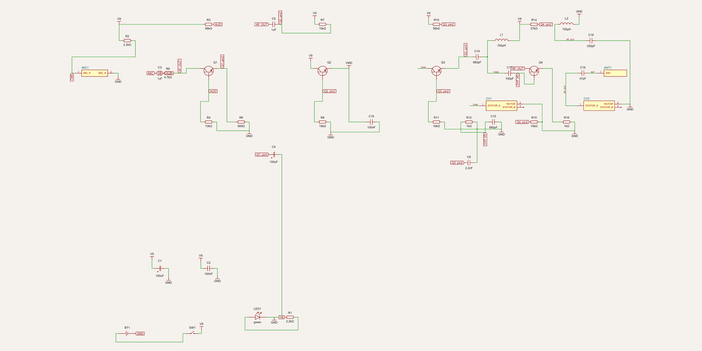

# Chapter 1 — How to read a schematic

> **Goal of this chapter:** by the end you can pick up any of the schematics
> in this repo (or anyone else's) and decode it: every symbol, every name,
> every wire, and — most importantly — you'll know the *procedure* for
> reading a whole schematic rather than just staring at it.
>
> **You need:** nothing. This starts from zero.

---

## 1.1 What a schematic is (and what it is not)

A schematic is **a map of electrical relationships**. It answers exactly one
question, over and over: *which metal leg of which part touches which other
leg?*

It is deliberately **not** a picture of the physical object. Compare:

* A **photograph** of a circuit board shows shapes, colours, sizes — and
  tells you almost nothing about how it works, because the copper is hidden
  inside.
* A **PCB layout** (chapter 2) shows the physical board faithfully — every
  pad, every copper track in its true position — and is *also* hard to read
  for the same reason a photograph of a city is a bad way to show the metro
  lines.
* A **schematic** throws away all physical truth — size, position, shape —
  and keeps only the *connections*. It is the metro map: not to scale,
  hopeless as a street map, perfect for answering "how do I get from A to
  B?"

That one decision — *keep the connections, throw away the geometry* — is
what makes a 41-part radio readable on one page. It is also why the
schematic looks like "separate little parts" rather than one connected
machine; chapter 3 is devoted entirely to that puzzle.

## 1.2 The three things every part tells you

Every component on a schematic carries three pieces of text. Learn to read
them as one unit and you've decoded 80% of the drawing.

Here is a real resistor from the AM transmitter, exactly as it appears on
the schematic:

```
        R1              ← ① its NAME  (the "reference designator")
   ┌──[ 2.2kΩ ]──┐      ← the SYMBOL (what kind of thing it is)
      2.2kΩ            ← ② its VALUE (how much of that thing it is)
```

1. **The name (reference designator).** `R1` means "the first Resistor".
   Names exist so the rest of the documentation — the parts list (BOM), the
   PCB, the assembly instructions — can talk about *this exact part*
   unambiguously. On the PCB, the very same name `R1` is printed next to its
   footprints. **Same name = same physical part** across all views.
2. **The symbol.** The shape drawn says what *kind* of thing it is —
   resistor, capacitor, transistor… (§1.4).
3. **The value.** `2.2kΩ` = 2200 ohms. The value's *unit* depends on the
   part type: ohms (Ω) for resistors, farads (F) for capacitors, henries
   (H) for inductors (§1.5).

> In these projects the value is usually written under the symbol (tscircuit
> prints it automatically from the code, e.g. `resistance="2.2kohm"`), and
> for LEDs the "value" is its colour.

## 1.3 The name alphabet (reference designators)

The letter is not random. Industry-wide convention, followed by all five
projects:

| Letter | Means | Examples from this repo |
|--------|-------|--------------------------|
| `R` | Resistor | `R1` power-LED resistor (radio-lab TX) |
| `RV` | Variable resistor / potentiometer | `RV1` volume control (AM-RX), `RV1` DEV trimmer (FM-TX) |
| `C` | Capacitor | `C1` bulk reservoir |
| `D` | Diode (incl. LEDs when named `LED…`) | `D1`/`D2` detector diodes; `LED1` power light |
| `Q` | Transistor (BJT or MOSFET) | `Q1` mic preamp; `Q1–Q3` lamp MOSFETs |
| `U` | Integrated circuit ("chip") | `U1` LM386 audio amp; `U2` ATtiny85 |
| `L` | Inductor / coil | `L1` tank coil |
| `Y` | Crystal / resonator | `Y1` 16 MHz crystal (μNode32U4) |
| `F` | Fuse | `F1` PTC resettable fuse |
| `FB` | Ferrite bead | `FB1`/`FB2` analog-supply filters (μNode32U4) |
| `J` | Connector / jack / header | `J1` USB socket; `J4` LED-panel terminal |
| `SW` | Switch | `SW1` power switch |
| `BT` | Battery | `BT1` 9 V cell |
| `MIC` | Microphone | `MIC1` electret capsule |
| `ANT` | Antenna | `ANT1` wire pad |
| `H` | Mounting hole | `H1–H4` |

Numbering usually follows the signal path — `Q1` is the first transistor the
signal meets, `Q4` the last. That's a habit, not a law, but these projects
follow it, which makes reading them easier.

## 1.4 The symbol alphabet — every symbol family in this repo

These are the symbols exactly as tscircuit draws them (the shapes below
describe the committed renders; open any `render-*-schematic.png` to see
them at full size).

### Passive parts (two pins, no direction of their own)

**Resistor — a plain rectangle** (some tools draw a zigzag; tscircuit uses
the international rectangle). It *resists* current: for a given voltage
across it, it lets exactly `I = V / R` through. Its job in almost every
circuit here is either to set a current (LED resistor), to divide a voltage
(two resistors in series, §1.7), or to load something deliberately.

**Capacitor — two parallel plates.** Think "tiny rechargeable tank": it
stores charge, blocks steady DC, but lets *changes* (AC, audio, radio
frequencies) through. `C` with no polarity mark = a plain (ceramic/film)
cap, can go in either way round.

**Electrolytic capacitor — plates where one is curved, plus a `+` mark.**
Same idea, much bigger tank — and it is *polarized*: the `+` leg must stay
at the higher voltage or the part can be destroyed. In this repo the `+` is
drawn on the schematic **and** printed on the PCB silkscreen; e.g. `C1`
(100 µF) across the 9 V rail, `+` toward the rail.

**Inductor / coil — a row of bumps.** A coil of wire. It resists *changes*
in current — the mirror image of a capacitor. At DC it's basically a piece
of wire; at radio frequencies it fights back hard. Combined with a
capacitor it makes the **LC tank**, the tuned circuit at the heart of every
radio in this repo.

**Variable capacitor — in these projects, a small box** labelled with its
pins (`STATOR_A`, `ROTOR`, …) because the physical part is mechanical.
Turn its knob → the plate area/overlap changes → capacitance changes → the
tank's resonant frequency changes. That's the **TUNE knob** of the AM
boards. (Its FM cousins `TRIM1` are "trimmers" — same idea, adjusted with a
small screwdriver.)

### Semiconductors (parts with a *direction*)

**Diode — a filled triangle pointing at a bar.** A one-way valve for
current: flows in the direction of the arrow (anode → cathode), blocked the
other way. The two ends have names you must know: **anode** (in) and
**cathode** (out, the bar side). In the AM receiver `D1`/`D2` are 1N34A
germanium diodes that *rectify* — turn AC radio waves into DC-ish audio.
Physical diodes mark the cathode with a painted stripe; the schematic marks
it with the bar; the two MUST agree.

**LED (light-emitting diode) — a diode symbol with two little arrows
flying out.** Same one-way valve, but it lights. Still a diode: polarity
matters, and it always needs something (usually a resistor) to limit its
current. `LED1 + R1` (green light, 2.2 kΩ) is the power indicator on all
four radio boards.

**BJT transistor (NPN) — a circle with three legs: base, collector,
emitter.** The word to hold on to: **amplifier valve**. A small current
into the **base** controls a much larger current from **collector** to
**emitter** — like a foot pedal where a light touch commands a heavy
engine. The three names are printed at the pins on these schematics (and
spelled `C`, `B`, `E` on the silkscreen). Almost every transistor in the
radio labs is an NPN: `Q1`…`Q4` on the AM-TX, `Q1`…`Q6` on the FM-RX.
(PNP transistors exist — the arrow on the emitter points the other way —
but none of these boards use one; their MOSFET cousins do appear on the
lamp and lighter boards: gate / drain / source instead of base / collector
/ emitter, and the "pedal" is a *voltage* instead of a current.)

### Boxes: chips and custom parts

**Integrated circuit (chip) — a rectangle with named pins around it.** Not
a mysterious blob: just many transistors/resistors pre-wired into a useful
block, with the block's pins drawn as labelled stubs. Examples: `U1` (LM386
audio amplifier, 8 pins: `IN_POS`, `OUT`, `VS`, `GND`…) on the AM receiver;
`U2` (ATtiny85 microcontroller, a *programmable* chip) on the lamp and
lighter.

**Custom/mechanical parts — also boxes, filled yellow-ish in these
renders.** Anything that is really a *mechanical object* the schematic
cannot meaningfully draw as a symbol family gets a box with named pins:
`MIC1` (electret microphone, pins `MIC_P`/`MIC_N`), `ANT1` (a pad you
solder a wire to, pin `ANT`), the battery `BT1`, switches `SW1`, the volume
pot `RV1`, speaker terminals. Chapter 3 explains why a box with *pin names*
is the honest way to draw these.

> **The habit to build:** when you meet any box, read its pin names first.
> Pin names tell you what the part offers the circuit: `VBUS`/`D+`/`D−`/`GND`
> on the USB connector, `IN_POS`/`OUT`/`VS` on the LM386. You can often
> guess a whole chip's purpose from pin names alone.

## 1.5 Values, units and the shorthand

Schematics compress units with SI prefixes:

| You see | It means | Because |
|---------|----------|---------|
| `2.2kΩ` | 2 200 Ω | k = kilo = ×1 000 |
| `1MΩ` | 1 000 000 Ω | M = mega = ×1 000 000 |
| `100nF` | 0.1 µF = 100 nanofarad | n = nano = /1 000 000 000 |
| `100uF` (or µF) | 100 microfarad | u/µ = micro = /1 000 000 |
| `47pF` | 47 picofarad | p = pico = /10¹² |
| `100uH` | 100 microhenry (inductor) | same µ, henries |
| `0.51ohm` | half an ohm (current-sense resistor) | — |

Handy intuition for the two families you'll meet most:

* **Capacitors:** pF = radio-frequency sized; nF = signal/audio sized;
  µF = power-supply sized. Watch it happen across the projects: `C6` is
  2.2 nF at the oscillator (RF), `C3` is 1 µF coupling audio, `C1` is 100
  µF smoothing the battery.
* **Resistors:** Ω = current-sensing or current-limiting-in-power; kΩ =
  biasing transistors and limiting LED current; 100 kΩ–1 MΩ = "hold this
  pin gently at a level" (pull-ups).

## 1.6 Wires, junctions — and the big one: **net labels**

### What a wire means

A line between two symbol pins means one thing only: **those pins are
electrically the same point**. Metal-to-metal. Not "a component", not "a
signal in the abstract" — just "these touch".

### Junctions

Where three or more wires meet, tools draw a dot (a junction). Where two
wires merely *cross* without a dot, they do NOT touch. Tscircuit's renders
mostly avoid the problem entirely by routing wires so they rarely cross —
because it has a better tool:

### Net labels — the key that unlocks every schematic in this repo

Look at any of these schematics and you'll see short wire stubs ending in a
**label in a box**, like `GND`, `V9`, `TANK`, `AUD`, `RF_OUT`:

```
   ┌────────┐
   │  V9    │◄── a stub with a name. This is a NET LABEL.
   └────────┘
```

The rule is beautifully simple, and it is **the single most important
sentence in this chapter**:

> **Two stubs anywhere on the drawing with the same net label are the same
> electrical point — exactly as if a wire were drawn between them.**

Why do it this way? Imagine drawing an actual wire from *every* ground pin
of a 41-part board to *every other* ground pin. The page becomes hairball.
Instead the designer says "all of these points are one net; I'll *name* it
`GND` and stop drawing it." Naming a net is the schematic's way of saying
"connected — trust me, off-page."

So when you see `V9` on the battery switch output, on four resistors, and
on a capacitor — all those pins sit on the same wire, even though no line
connects them on paper. **Reading a modern schematic is largely collecting
net labels.**

Net names in this repo follow a convention worth noticing:

| Net | Meaning | Where you'll see it |
|-----|---------|---------------------|
| `GND` | Ground, 0 V, the common return | everywhere |
| `V9` / `V5` / `V12` / `VCC` | positive supply rails (9 V, 5 V, 12 V) | everywhere |
| `VMD` | "modulated supply" — the 9 V rail with your voice stamped on it | AM-TX |
| `TANK` | the LC tank's hot node — the tuned circuit that sets the frequency | AM-TX, both FM boards |
| `AUD` / `AF_OUT` | audio-frequency signal travelling between stages | both TX |
| `RF_OUT` | the finished radio-frequency output | AM-TX |
| `VAR` | the varactor (variable-capacitance diode) bias node | FM-TX |
| `MIC` | the raw microphone node | both TX |

When a net name is also a *story*, reading it teaches you the architecture:
the AM transmitter literally has a net called `VMD` because its big idea is
"a power rail that wiggles with your voice."

### Power and ground symbols

Many tools draw ground as a stack of shrinking horizontal lines and power
as a bar/arrow. **Tscircuit renders power and ground as text net labels**
(`GND`, `V9`) — same meaning, plainer drawing. Either way: every `GND` is
one giant net, the circuit's common return path, and the point all voltages
are measured against.

## 1.7 Three mini-recipes you'll use constantly

These little patterns appear on every board in the repo. Learn them once as
*patterns* and schematics stop being lists of parts and become sentences.

**1. The LED + resistor pair.** `V9 ── R1 (2.2k) ──►│── GND` (the `►│` is
the LED). The resistor sets the current: `(9 V − 2 V) / 2.2 kΩ ≈ 3 mA`.
Whenever you see a resistor in series with an LED, that's the resistor
stopping the LED from burning.

**2. The voltage divider.** Two resistors in series between a rail and
ground; the middle point is a fraction of the rail. `R10 (56k)` over
`R11 (10k)` from 9 V puts the transistor base at
`9 × 10/(56+10) ≈ 1.36 V` on the AM-TX oscillator. Bias dividers feed most
transistor bases on all four radio boards.

**3. The decoupling pair.** A big electrolytic (`100 µF`, the reservoir for
slow demand) plus a small ceramic (`100 nF`, the fast local supply) from a
rail to ground, right where the rail arrives. `C1 + C2` on every battery
board. Once you see it, you can mentally "collapse" it: *that's just the
power supply keeping itself steady* — and move on to the interesting parts.

## 1.8 The reading procedure — how to read a WHOLE schematic

Symbols are vocabulary; this is grammar. Follow it mechanically, every time:

1. **Find the power source.** Battery `BT1`, USB `J1`, terminal `J1`.
   That's where energy enters. Note the rails it creates (`V9`, `V5`…).
2. **Find ground.** Collect every `GND` label. You now know the frame the
   whole circuit is measured against.
3. **Find the inputs and outputs.** Microphone, antenna, speaker, LED
   panel, electrodes. The circuit exists to move something from input(s) to
   output(s).
4. **Trace the signal path from input to output.** Follow the wire/net
   labels from the input pin forward. Each cluster of parts you pass
   through is a *stage* — ask of each one: *what does this do to the
   signal?* (amplify it, filter it, detect it, switch it…)
5. **Treat the power-wiring as scenery.** Wires that only go rail→part→GND
   (bias dividers, decoupling pairs) are the stage crew, not the actors.
   You already know the recipes (§1.7); notice them and move on.
6. **Chunk it into blocks and name them.** "Power → mic preamp → modulator
   → oscillator → final → antenna." Congratulations — you're now reading
   the way engineers read, by *blocks*, not parts.

Schematics drawn by tools (like these) usually lay out left→right in signal
order, top = power, bottom = ground — the procedure above then feels like
reading a book.

## 1.9 Worked example — your first real schematic

Open the AM transmitter's schematic now (image below; for zooming, open
`radio-lab/render-tx-schematic.svg` in a browser, or run
`cd radio-lab && tsci dev transmitter/index.tsx`):



Apply the procedure, and this is what you should find (check each claim
against the drawing!):

1. **Power** enters bottom-left: `BT1` (9 V battery) → `SW1` (slide
   switch). The switch's output stub is labelled `V9` — the main rail. A
   decoupling pair `C1`/`C2` hangs rail-to-ground (recipe #3), and
   `R1 + LED1` make the power light (recipe #1).
2. **Ground**: every `GND` stub — battery minus, cap minus, LED cathode,
   the emitters' resistors… one big net.
3. **Input**: `MIC1`, top-left — an electret microphone box with pins
   `MIC_P` / `MIC_N`. `R2` feeds it power; `C3` couples its signal onward
   (blocks DC, passes your voice).
4. **Signal path, stage by stage**:
   * `Q1` — first transistor (NPN circle). Its input is the small
     microphone signal, its collector output is a much bigger copy:
     the **audio preamplifier**.
   * `C5` → `Q2` — the **modulator**: an emitter follower whose output is
     the net `VMD`, a power rail that *wiggles with your voice*.
   * `Q3` with `L1`, `CV1`, `C14`, `C15` — the **carrier oscillator**: a
     Colpitts oscillator whose LC tank (net `TANK`) rings at ~0.65–0.85 MHz,
     tuned by the `CV1` knob.
   * `C17` → `Q4` with `L2`, `CV2`, `C18` — the **modulated final
     amplifier**, fed from `VMD`, so the carrier's *amplitude* follows your
     voice: amplitude modulation, AM.
   * `C16` → `ANT1` — the **antenna**: the finished signal leaves.
5. Blocks: `power → mic → preamp → modulator → oscillator → final →
   antenna`. That's the whole board in one sentence — and it's the same
   architecture a broadcast station uses, shrunk to microwatts.

If you followed that, you have just read a real transmitter. The full
stage-by-stage story with the numbers is chapter 5's tour.

## 1.10 Traps that catch every beginner (once)

* **Polarity is not optional.** Electrolytic caps (curved plate, `+`),
  diodes and LEDs (triangle direction), transistors (`C/B/E`) and chips
  (pin 1) all have a "right way round". The schematic encodes it; the PCB
  repeats it; the parts physically mark it (stripe on the diode, long leg
  of an LED, notch/dot on a chip). All three must agree.
* **A net label is a wire.** `GND` here and `GND` there: connected. There
  is no "maybe" about it.
* **Unconnected-looking stubs matter.** An input left open (e.g. a
  microphone node with no resistor feeding it) is usually a design smell;
  every stub on these schematics is deliberate.
* **Size on paper means nothing.** A tiny `0.51 Ω` resistor (arc-lighter's
  `RE1`) can be the physically biggest resistor on its board because it
  carries amps; a huge-value `1 MΩ` can be the smallest part. The
  schematic does not show physical size — the PCB does.
* **Same name = same part everywhere.** `C3` on the schematic, `C3` on the
  PCB silkscreen, `C3` on the BOM, `C3` in the tutorial. Use this to jump
  between documents freely.

---

## Check yourself

1. On a schematic you see two wire stubs, one labelled `TANK` near a
   transistor's collector, one labelled `TANK` across the page near a
   capacitor. Are they connected?
2. What are the three pieces of information every schematic part gives you?
3. A part is named `Q2`. What family is it, and what are its three pins
   called (if it's the kind used in the radio labs)?
4. `C4` is drawn with one curved plate and a `+`. What does that tell you,
   and what happens if you install it backwards in real life?
5. In §1.9, what is the job of `R1` and `R2` in `R2 ── MIC1 ── GND`?

<details>
<summary>Answers (click to unfold)</summary>

1. Yes — identical net labels are the same electrical node, no matter how
   far apart they're drawn.
2. Reference designator (name), symbol (kind of part), value.
3. A transistor. If a BJT: base, collector, emitter.
4. It's a polarized electrolytic capacitor; the `+` leg must sit at the
   higher voltage. Reversed electrolytics can vent or burst when power is
   applied.
5. `R2` powers the electret capsule's internal amplifier (a small, safe
   current from the 9 V rail); there is no "R1" in that snippet — R1 is
   back in the power section feeding the power LED.
</details>

---

**Next:** [Chapter 2 — how to read a PCB layout →](./02-pcb-literacy.md)
