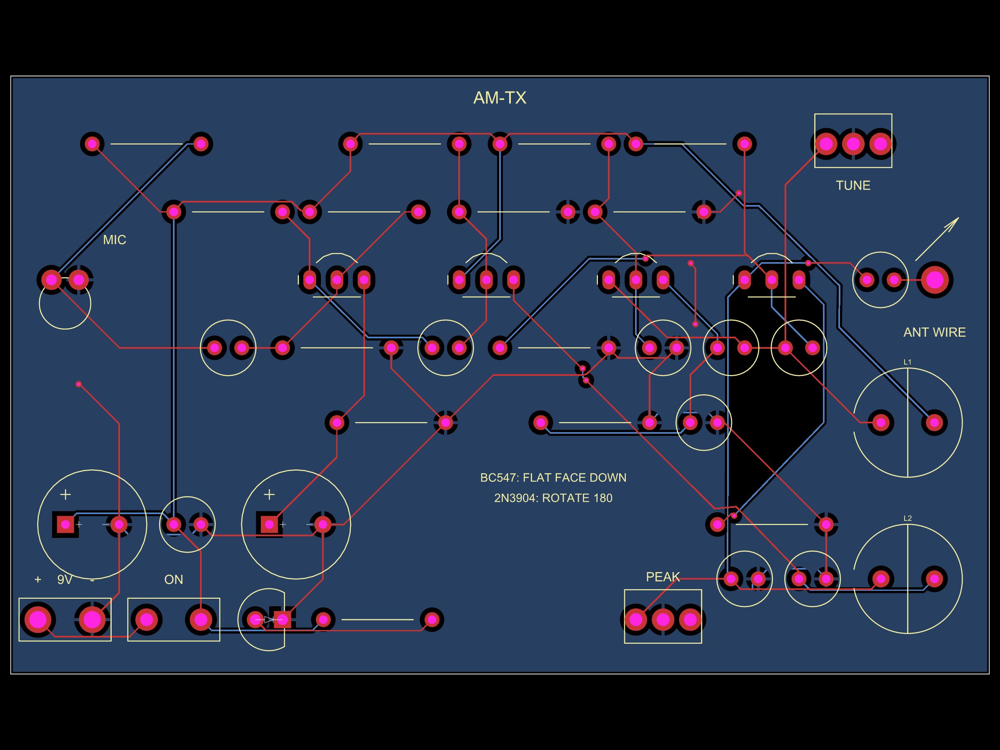

# Chapter 2 — How to read a PCB layout

> **Goal of this chapter:** understand what a PCB physically *is*, then
> decode any layout drawing — layers, pads, traces, vias, pours, silkscreen
> — and navigate between a schematic and its board without getting lost.
>
> **You need:** chapter 1 (symbols, reference designators, nets).

---

## 2.1 What a PCB actually is

A printed circuit board is a **sandwich**:

```
        ┌──────────────────────────────┐
        │  copper: TOP layer           │  ← "F.Cu" — red in these renders
        ├──────────────────────────────┤
        │  fibreglass insulator (FR4)  │  ← the board itself
        ├──────────────────────────────┤
        │  copper: BOTTOM layer        │  ← "B.Cu" — blue in these renders
        └──────────────────────────────┘
```

plus a green solder-mask coating over the copper (with holes where solder
should go), and the **silkscreen** — cream/white printing — on top of
everything.

Every board in this repo is a **2-layer** board: signals can run on the top
(red), on the bottom (blue), or hop between them through **vias**. All of
them dedicate the whole bottom layer to a **ground pour** (§2.7) except the
lamp's LED panel, which pours +12 V instead (it still returns through
wires).

The trick that makes a PCB work: the copper is **etched** — everywhere the
drawing shows a trace or a pad, copper survives; everywhere else it's
removed. So the PCB drawing is really a picture of *surviving copper*, and
every piece of it belongs to exactly one net from the schematic.

## 2.2 The golden rule of layout drawings

> **The PCB shows WHERE. The schematic shows WHAT-CHECKS-WHAT.**

Two pads touching the same copper = same net. A trace is just "one net,
drawn in position". When reading a layout you constantly ask *"which net is
this piece of copper?"* — and the answer always comes from the schematic
(chapter 1). The two drawings are one circuit in two projections.

## 2.3 Footprints — a part's landing site

A **footprint** is the pattern the PCB gives one physical part: its pads,
its silkscreen outline, and (invisible in a photo, drawn in the layout) its
**courtyard** — a keep-out zone so neighbouring parts can't collide.

Reading footprints is about recognizing shapes. On the committed renders
(the example below is the AM transmitter):



* **Two round pads in a straight line** with a thin rectangle outline
  between them = a through-hole **resistor** (e.g. `R1`). The rectangle is
  the body; the distance between pads is the part's "pitch".
* **Two pads with no rectangle** = a small **ceramic/film capacitor** (`C2`).
  Non-polarized: either way round.
* **A round pad + a SQUARE pad** (or a `+` on the silkscreen) = a
  **polarized** part, usually an **electrolytic capacitor** (`C1`): square
  / `+` = positive leg. (The same square-pad-means-`+`-or-pin-1 convention
  is used for diodes: square = cathode on the radio boards.)
* **Three pads in a row with a half-moon (D) outline** = a **transistor in
  a TO-92 package** (`Q1`…). The flat side of the outline shows which way
  the flat face of the physical part points. This repo's boards even print
  the assembly trick: "BC547: FLAT FACE DOWN / 2N3904: ROTATE 180".
* **A big circle with two pads inside** = a **radial inductor/coil** (`L1`,
  `L2` on the AM boards).
* **A group of pads in a rectangle outline** = a mechanical or multi-pin
  part: the tuning capacitor `CV1`/`CV2` (three pads: stators + rotor), the
  volume pot `RV1`, the speaker terminal, the USB connector, pin headers.
* **Small copper rectangles with two tiny pads, no holes** = **surface-mount
  (SMD)** parts — e.g. every 0603 resistor/capacitor on the μNode32U4
  board. Size classes (0603, 0805, 1206…) are just pad-spacing patterns.
* **A big square with legs on all four sides** = a **QFP chip** — the
  ATmega32U4's 44 legs, with pin 1 marked (§2.6).

The name printed next to every footprint (`R1`, `C1`, `Q3`…) is the same
reference designator as on the schematic. **That label is the bridge
between the two drawings** — you navigate by it.

## 2.4 Pads, holes and (on real boards) plating

* A **pad** is the copper ring a leg is soldered to. For through-hole parts
  it has a **drilled hole** in the middle (drawn as the darker inner
  circle); for SMD parts it's a solid copper rectangle on the surface.
* Hole diameters are generous on the beginner boards (0.8–1.6 mm) so parts
  drop in and hand-soldering is easy.
* **Square pad = pin 1 / polarity**, universally. When you build any of
  these boards, finding the square pad answers "which way round?".

## 2.5 Traces — copper wires with a job

A **trace** is the copper strip realising one net between pads. Two things
to read off a trace:

**Its layer** (colour): red = top, blue = bottom in these renders. A net
that must cross another net simply drops through a via to the other layer
(§2.6).

**Its width** — and this is physics, not style. A trace is a wire, and a
thin wire carrying big current heats up. Rules of thumb you can *see* in
this repo:

* ~0.15–0.25 mm: signals (milliamps — anything goes).
* 0.5 mm: USB power on μNode32U4.
* 0.6–0.8 mm: the lamp's LED currents and the arc-lighter's 2–3 A current
  loop. The arc-lighter README's hand-routed 0.8 mm loop
  (`BAT+ → LOCK → Q1 → coil → Q2 → GND`) exists precisely because its
  autorouter was happy to send amps down a 0.15 mm trace — a mistake the
  layout corrects by hand.

When you see one trace conspicuously fatter than its neighbours, it's
carrying either power or fast-changing current. On the AM-TX render, the
power entry traces around `BT1`/`SW1` are visibly fatter than the signal
web in the middle.

One more real-world detail these boards teach: at radio frequencies even
*geometry* is a component — the FM boards keep every tank trace short
("keep the leads SHORT", the coil wound 3 turns on a 5 mm form) because a
centimetre of wire is ~5–10 nH of inductance at 100 MHz.

## 2.6 Vias — the elevators

A **via** is a tiny plated hole whose only job is to carry a net from one
copper layer to the other. Drawn as a small ring (0.6 mm pad, 0.3 mm hole
on these boards). No component goes in it — it's soldered-free plumbing.

Why you see so few vias on these particular boards: the bottom layer is a
solid ground pour, so every `GND` pin just needs *one* little via straight
down to the pour, and the top layer keeps almost all the routing room.

## 2.7 Copper pours — the biggest copper shape on the board

Look at the AM-TX render again: the whole bottom layer is one solid sheet
of copper connected to `GND`. That's a **ground pour** (or ground plane) —
`<copperpour connectsTo="net.GND" layer="bottom" .../>` in every board's
code. Why it's there:

* **Every ground pin gets a short, direct path home** — a via to the sheet
  instead of long routed traces.
* **Return currents flow underneath their signals**, which keeps the loop
  area small: less hum, less unintended radiation, better-behaved radio
  circuits. On VHF boards (FM lab) this is not decoration, it's part of the
  design.
* **It sinks heat** and shields.

Now look closely at a GND pad sitting in the pour: the copper around it is
**broken by little bridges** — that's a **thermal relief**, four narrow
spokes instead of full contact. Without it, soldering a through-hole pad
onto a solid sheet would be hopeless: the sheet steals all your iron's
heat. The spokes let the pad heat up locally. (On the LED panel, the pour
carries `V12` instead of GND — the positive rail feeds 18 resistors —
same physics, different net.)

## 2.8 Silkscreen — the board talking to you

The cream printing is documentation, printed *on the product*:

* **Reference designators** next to every footprint — again, your bridge to
  the schematic.
* **Polarity marks**: `+` on electrolytics and battery terminals, the dot /
  square pad on chips.
* **Instructions**: these boards print their user manual on themselves —
  `TUNE`, `PEAK`, `ANT WIRE`, `VOL`, `BC547: FLAT FACE DOWN`, the coil
  winding spec `L1: 3T ON 5MM FORM`, `ANT: MAX 20CM WIRE` on the FM-TX.
  That last one is a *legal* instruction (stay inside licence-free limits),
  printed where you need it.

When you build a board, the silkscreen is your assembly sheet: insert parts
to match the outline, line up polarity marks, done.

## 2.9 Board outline, holes, and the edge

* The **outline** (thin border) is where the board gets cut.
* **Mounting holes** `H1–H4` (3.2 mm for M3 screws) are unplated — pure
  mechanics, no net.
* **Edge placement matters** sometimes: on μNode32U4 and arc-lighter, the
  USB connector deliberately overhangs the board edge so a plug's moulding
  can seat. The code comment says exactly how far inboard the footprint
  origin sits (2.75 mm) to achieve that.

## 2.10 DRC — the referee

Before any board can be made, software runs a **Design Rule Check**: are
traces thick enough, spacing big enough, holes ringed properly, courtyards
clear? A DRC error means *the factory cannot build this or you cannot
solder it* — e.g. "clearance" errors (two coppers too close ⇒ risk of
short), or a courtyard collision (two bodies overlapping). All boards in
this repo pass DRC with zero errors (their `verify.mjs` audits re-check it
headlessly — see each project README's "verification" section).

## 2.11 The reading procedure — how to read a whole layout

1. **Orient yourself.** Top of the render = top of the board. Find the
   connectors/edge features (USB on the left edge of μNode32U4; battery
   pads bottom-left on the radios; screw terminals on the lamp).
2. **Find the biggest, most recognizable parts.** The QFP chip, the TO-220
   MOSFETs, the coils, the pin headers, the trimmer boxes. Use their
   silkscreen names to anchor the schematic in your head.
3. **Locate power entry and follow the fattest traces.** They lead to
   regulators/fuses/bulk caps — the power section almost always matches the
   schematic's power block position.
4. **Pick ONE net from the schematic and find it on copper.** Say `TANK` on
   the AM-TX: from `Q3`'s collector pad, follow the trace to `C14`, `L1`,
   `CV1`'s stator. You've just verified the schematic's promise in copper.
5. **Notice the pour and the vias into it** — that's your ground.
6. **Read the silkscreen instructions** — they were written for the person
   holding the soldering iron (you).

## 2.12 Worked example — the AM-TX board

Using the render above (§2.3):

* Bottom-left: `+ 9V −` pads (`BT1`), the `ON` switch `SW1` beside them,
  `C1` (big electrolytic, `+` marked) and `C2` — the power section, and
  the traces between them are the fattest on the board.
* Left-middle: `MIC` label and `MIC1`'s two pads — the input.
* Middle of the board: the four three-pad transistor footprints `Q1`…`Q4`
  in a left-to-right line — the signal path, in order, exactly like the
  schematic (§1.9). Next to them their bias resistors (`R3/R4`, `R7/R8`…).
* Right side: the two coils `L1`, `L2` (big circles), the tuning boxes
  `CV1` (labelled `TUNE`) and `CV2` (`PEAK`), and the `ANT WIRE` pad.
* Bottom layer: the blue ground pour with thermal-relief pads stitching
  into it.
* Centre silkscreen: the transistor-orientation manual.

Notice what you *didn't* need: any guesswork. Every claim came from
silkscreen names + shapes + the schematic's net list. That's the whole
skill.

---

## Check yourself

1. In these renders, what do red and blue mean?
2. You're holding the physical AM-RX board and must insert `C1` (100 µF
  electrolytic). How do you find its place and orientation?
3. Why does the FM-TX board say "keep the leads SHORT" — what electrical
   property of a length of wire is the designer worried about?
4. A pad sits in the ground pour joined by four narrow spokes instead of
  full contact. Name the feature and its purpose.
5. Why are the arc-lighter's battery-to-coil traces 0.8 mm while signal
   traces elsewhere are 0.15 mm?

<details>
<summary>Answers</summary>

1. Red = top copper layer, blue = bottom copper layer.
2. Find the silkscreen `C1` (near the battery pads); the square pad /
   silkscreen `+` is the positive leg; the electrolytic's own negative
   stripe goes to the round pad.
3. Length adds inductance (a few nH per cm). At 100 MHz that's a real
   impedance that detunes the tank — the schematic's values assume short
   leads.
4. A thermal relief: it slows heat leaking into the pour so the pad can
   reach soldering temperature.
5. Current. The driver loop pulls 2–3 A pulses; ~0.15 mm of copper would
   heat (and act as a fuse). Trace width is chosen for the current the net
   carries.
</details>

---

**Next:** [Chapter 3 — why the schematic shows "separate parts": two views, one circuit →](./03-two-views-one-circuit.md)
