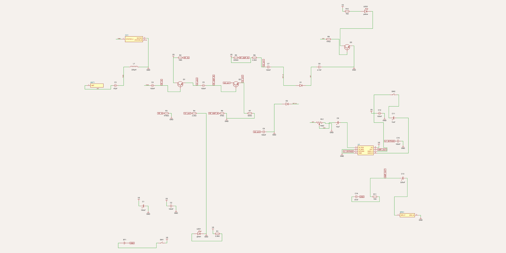
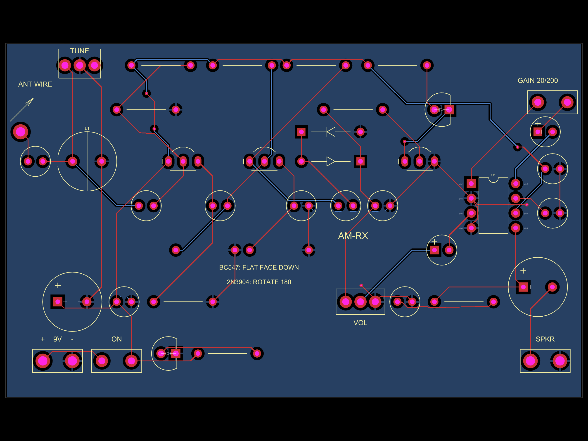

# Chapter 5 — Guided tour: Radio Lab (the AM pair)

> **What you need:** chapters 1–2 (symbols, nets, PCB basics). Chapter 3
> helps but isn't required.
>
> **What you'll be able to do afterwards:** read both boards of
> [`radio-lab/`](../radio-lab) unaided — the AM **transmitter** (a 4-transistor
> radio station) and the AM **receiver** (the radio that hears it) — and
> explain every stage's job and its key numbers.

**The project in one paragraph.** You speak into an electret microphone. A
few transistors later, your voice is riding a radio wave at ~0.75 MHz — the
AM (medium-wave) band — radiated from a metre of wire. Across the room, the
receiver's coil-and-knob circuit picks *your* frequency out of the air,
strips the carrier away, and plays your voice through a speaker. It is the
architecture of a real broadcast station and a real radio, shrunk to
microwatts you can legally operate (check your country's rules — the
tutorial covers the US FCC case).

```
TRANSMITTER (am-tx)                       RECEIVER (am-rx)

mic → preamp → modulator ─┐               antenna → LC tank (TUNE)
                          │                          → buffer → RF amp
steady oscillator ────────┤→ final amp → wire  →→→   → diode detector
   (TUNE knob sets         (amplitude follows        → volume → LM386 → speaker
    the carrier freq)       your voice = AM)
```

The two boards are designed as a *pair*: the receiver's `TUNE` covers the
transmitter's whole carrier range, and its "signal LED" glows when you've
found the carrier — radio-wave capture as a game.

**Open the views while you read:**

```bash
cd radio-lab && tsci dev transmitter/index.tsx   # or receiver/index.tsx
```

…or zoom the committed renders (also embedded below), or paste
`standalone/am-tx-playground.tsx` / `am-rx-playground.tsx` into
<https://snippets.tscircuit.com>.

---

## Part A — The transmitter (am-tx)


Apply chapter 1's procedure: power bottom-left, input top-left, then follow
the signal left→right. Seven stops.

### A1. Power entry — `BT1`, `SW1`, `C1`, `C2`, `LED1`, `R1`

A 9 V battery through a slide switch becomes the rail `V9`. The
**decoupling pair** (chapter 1 recipe #3): `C1` 100 µF is the reservoir
(handles the slow pushes of loud audio), `C2` 100 nF is the fast local
supply (handles everything too quick for `C1`). The power light is recipe
#1: `R1` 2.2 kΩ sets `(9−2)/2.2k ≈ 3 mA` through the green LED.

*Why it matters here:* audio stages draw *rhythmically* — every syllable is
a gulp of current. Without the pair, the rail sags on your voice and the
oscillator wanders with it (the FM lab's chapter 6 shows just how badly).

### A2. Microphone — `MIC1`, `R2`, `C3`

`MIC1` is an electret capsule: a microphone with a built-in one-transistor
amplifier that needs a trickle of power. `R2` (2.2 kΩ) feeds it from `V9`;
the capsule's output pin (net `MIC`) now carries your voice as a small AC
signal (±10–30 mV) *sitting on a DC level*. `C3` (1 µF) is the **coupling
capacitor**: DC blocked, voice passed — the classic way to hand a signal
between stages without dragging their bias voltages along.

### A3. Audio preamplifier — `Q1` and friends

The first transistor stage. Read it in three moves (this same three-move
read works on *every* common-emitter stage in all four radio boards):

1. **Bias:** `R3` 68 kΩ over `R4` 10 kΩ (a divider, recipe #2) parks the
   base at `9 × 10/78 ≈ 1.15 V`.
2. **Current:** the emitter resistor `R6` 560 Ω sets the stage's current,
   ~1 mA — and `C4` 100 µF **bypasses** it for audio, so the emitter is an
   AC ground while keeping the DC stability.
3. **Load & gain:** the collector load `R5` 4.7 kΩ converts the transistor
   current back into a voltage. With the emitter bypassed, voltage gain ≈
   `R5 / r_e` where `r_e ≈ 33 Ω` at this current → **≈140×**. Millivolts of
   voice become volts at `Q1`'s collector (net `AF_OUT`).

### A4. The modulator — `Q2` and the birth of net `VMD`

The cleverest block on the board. `Q2` is an **emitter follower**: output
follows input, no voltage gain — but its *output is a power rail*. Look at
the schematic: `C5` (1 µF) couples `Q1`'s audio onto `Q2`'s base; `R7`/`R8`
hold that base at ~5.4 V; the emitter therefore idles at ~4.7 V **and
wiggles with your voice**. That emitter is the labelled net `VMD`.

`VMD` feeds exactly one thing: the final amplifier (A6). So the final's
*power supply* carries your voice — and its output amplitude cannot help
but follow it. That is **amplitude modulation, high-level style**: exactly
how big transmitters do AM. `C19` (100 nF) is `VMD`'s RF ground — it lets
radio-frequency currents return to ground without letting the audio
through.

> A design lesson hidden in the comments: the *oscillator* deliberately
> runs from steady `V9`, **not** from `VMD`. An oscillator fed from a
> voice-wiggling rail gets frequency-modulated by it (±27 kHz in
> simulation — wider than an AM radio can hear), which would distort.
> Clean AM = steady oscillator + modulated final.

### A5. The carrier oscillator — `Q3`, `L1`, `CV1`, `C14`, `C15`

A **common-base Colpitts oscillator** — the workhorse of simple radios.
Two ideas:

**The tank sets the frequency.** `L1` (100 µH coil) resonates with its
capacitance-to-ground: `CV1` (the TUNE knob, 10–280 pF) in parallel with
`C14` and `C15` in series (680 pF + 680 pF in series = 340 pF). Tank total
≈350–630 pF, so

```
f = 1 / (2π·√(L·C))  ≈  0.65 … 0.85 MHz
```

Turn the knob, slide the station. The whole tank shares one net — labelled
`TANK`, natch — `Q3`'s collector, `C14`'s bottom, `L1`'s top, `CV1`'s
stator.

**The Colpitts trick keeps it ringing.** An oscillator needs feedback: a
bit of its output, returned in phase. `C14`/`C15` are a capacitive
**divider**; `Q3`'s emitter sits at their midpoint, so a fraction of the
collector swing re-enters at the emitter, in phase, and the transistor
re-amplifies it. Base bias: `R10`/`R11` (56 k/10 k) at ~1.36 V, with `C6`
2.2 nF grounding the base at RF (that's what "common-base" means *at the
frequency of interest*). `R12` 1 kΩ sets ~0.7 mA.

Notice `L1`'s other end goes to `V9`, not ground — "the coil IS the DC
feed": at DC a coil is nearly a short (feed the collector!), but at RF it's
high impedance (the tank floats free). One part, two jobs.

### A6. The modulated final — `Q4`, `L2`, `CV2`, `C18`

`C17` (100 pF, deliberately light) drips a sample of the steady carrier
onto `Q4`'s base; `R14`/`R15` bias it; `R16` sets ~1.7 mA. The collector
load is not a resistor but a **tuned tank**: `L2` 100 µH (fed from `VMD`!)
in parallel with `CV2` (the PEAK knob) + `C18` 330 pF.

Two things happen. Because `L2` hangs from `VMD`, the collector swing is
bounded by the voice-carrying rail → **the output's amplitude follows your
voice**. And because the load is a tank tuned to the carrier, the
harmonics a hard-driven transistor produces are filtered out — simulated
≥27 dB down, comfortably beyond the ≥20 dB that US FCC §15.219(c) requires
outside the AM band. (The README's "design review" tells the story of why
that tank exists: the earlier resistor-load version failed that number.)

### A7. The antenna — `C16`, `ANT1`

At 0.75 MHz the wavelength is ~400 m; your 1–2 m of wire is an
*electrically short* antenna that behaves mostly like a ~15–30 pF
capacitor. `C16` (47 pF) feeds it lightly from net `RF_OUT` so the antenna
doesn't detune the output tank. Legal limits (US): ≤100 mW input to the
final (this board: ~8 mW), antenna+ground ≤3 m, spurious ≥20 dB down —
all covered in the tutorial PDF.

### A8. Reading the PCB


Orient by the silkscreen: `+ 9V −` battery pads and `ON` bottom-left;
`MIC` label left-middle; `TUNE` knob-box upper-right; `PEAK` lower-right;
`ANT WIRE` far right edge. The four transistors run left→right in signal
order (`Q1`…`Q4`), each with its bias resistors around it — the PCB is the
schematic's reading order made physical. All through-hole parts sit on a
2.54 mm grid, so **the PCB doubles as a perfboard placement guide** — you
can build it without ordering boards (the tutorial PDF shows how). Bottom
layer (blue): solid ground pour, thermal-relief pads.

One assembly note the board prints on itself: `BC547: FLAT FACE DOWN /
2N3904: ROTATE 180` — two common transistors with mirrored pinouts; the
silkscreen's half-moon outlines only fit one of them, hence the note.

---

## Part B — The receiver (am-rx)



A **TRF receiver** (tuned radio frequency) — the direct ancestor of every
radio you've owned, and small enough to understand completely. Signal
chain, left to right:

```
antenna → LC tank(TUNE) → buffer Q1 → RF amp Q2 → detector D1/D2
        → volume RV1 → LM386 → speaker        [+ signal LED Q3/LED2]
```

### B1. Power — same recipe as the transmitter

`BT1`→`SW1`→`V9`, `C1`/`C2` decoupling pair, `R1`+`LED1` power light.
Identical to A1 — by design: recognizing "the power block" in two seconds
is a skill, and now you have it.

### B2. Antenna + the LC tank — `L1`, `CV1`, `C3`, `C4` — *the heart*

Here is where "tuning" physically happens. `L1` 220 µH in parallel with
`CV1` (10–280 pF) resonates at

```
f = 1/(2π√(L·C))  →  ~0.6 … 1.7 MHz
```

— which spans the entire AM broadcast band (in Vietnam: 526.5–1606.5 kHz)
*and* the companion transmitter's range. At resonance the tank's impedance
peaks, so of all the radio signals the wire collects, only the one at the
tank's frequency survives onto `Q1`'s base with any size. Turn `CV1` and
you slide that highlighter across the whole band.

`C3` (47 pF) couples the 1–2 m wire into the tank *lightly* — a big
antenna would load the tank and dull its selectivity. `C4` (100 nF) passes
the selected RF onward while blocking DC through the coil (remember: a
coil is a short at DC).

### B3. Buffer + RF amplifier — `Q1`, `Q2`

`Q1` is an **emitter follower** (buffer) biased *deliberately light* —
`R2` 1 MΩ / `R3` 470 kΩ, ≈320 kΩ input resistance — so the tank keeps its
sharpness. Its job is repetition without loading: the tank voltage
reappears at its emitter, at low impedance, ready to drive the next stage.

`Q2` is the **common-emitter RF amplifier** — the same three-move read as
A3: divider `R5`/`R6` biases, `R7` 820 Ω + bypass `C6` set the current,
load `R8` 2.2 kΩ gives gain ≈ `R8/r_e` ≈ 2200/26 ≈ **80×**. A millivolt of
selected RF becomes ~80 mV — enough for the detector to work on.

### B4. The diode detector — `D1`, `D2`, `C8`, `RV1` — *where radio becomes audio*

The magic moment. `C7` (100 nF) hands `Q2`'s amplified RF to net `DET_IN`
(DC blocked). Then:

* `D2` (anode to ground) **clamps** the negative RF peaks at about −0.2 V.
  This looks like a detail; it is not — it is the **DC return path**.
  Without `D2`, `D1` would charge `C7` on the first few peaks and then
  simply stop conducting (no DC can flow through a cap into the pot), and
  the detector would sit dead below 90 mV at *any* signal level. The
  tutorial's simulation section tells exactly that story.
* `D1` passes the positive peaks onto `C8`.
* `C8` (4.7 nF) with the volume pot `RV1` (10 kΩ) is the **envelope
  filter**: `R·C = 47 µs` — fast enough to track ~3 kHz audio, slow enough
  to bridge the ~1.2 µs RF cycles. What's left is the audio envelope: your
  voice, recovered.

`D1`/`D2` are **1N34A germanium** diodes: their 0.2 V forward drop wastes
less of a small signal than silicon's 0.6 V — the classic crystal-radio
choice.

**The signal LED** — `R9` watches net `DET`; when a strong carrier is
tuned in, `DET` jumps to a volt or more, `Q3` turns on, `LED2` glows: a
visual "you found the station", which makes hunting the transmitter fun.

### B5. Audio out — `RV1`, `C9`, `U1` (LM386), `SW2`, `C11`, speaker

`RV1`'s wiper picks off a slice of the audio (that's the VOLUME knob) →
`C9` (10 µF) blocks DC → `U1`, an LM386 audio-power chip — the one *chip*
on the board, drawn as a labelled box (base gain 20, set by the
manufacturer). Strap `SW2`+`C11` (10 µF) across its gain pins and gain
becomes 200 for weak stations. `C10` quiets its bypass pin; `R11`+`C14`
(the 10 Ω + 47 nF "Zobel") keep it stable driving a speaker; `C13`
(220 µF) couples OUT to the 8 Ω speaker terminals `SPK1`.

### B6. Reading the PCB



Left edge, top to bottom: `ANT WIRE` pad, then the big coil circle `L1`
with the `TUNE` box `CV1` above it — the tank physically together, because
at a MHz you *want* the tank compact. Then `Q1`/`Q2` (buffer, amp) with
their bias resistors, then the two diodes `D1`/`D2` (note the square pads
= cathodes!), `VOL` pot lower-middle, the DIP-8 outline `U1` with its
labelled pins right of centre, and `SPKR` terminals bottom-right. Same
left→right signal order as the schematic — now you can *see* the pairing
between the two drawings, and the ground pour (blue) under everything.

---

## Part C — Using the pair (and what to notice)

1. Power the transmitter, set `TUNE` to mid-range. Speak close to the mic.
2. On the receiver, sweep `TUNE` until `LED2` lights and the hiss
   collapses into your voice. Adjust transmitter `PEAK` for maximum
   loudness — you are peaking the output tank onto the carrier, i.e.
   tuning two LC circuits into agreement.
3. Experiments the tutorial walks you through: overmodulation (shout —
   distortion on the RX); range vs antenna length; tuning precision vs
   `C3`; and pointing out that the receiver also picks up *real* AM
   broadcast stations with a longer wire.

**Build it for real:** all through-hole, 0.1" grid → perfboard-friendly;
the BOM with orderable part numbers and the perfboard guide are in
`radio-lab/docs/radio-lab-tutorial.pdf` (with the errata table in the
README). `npm run math` re-derives every number quoted above;
`npm run sim` re-runs the simulated checks on the routed board.

---

## Check yourself

1. Why does the oscillator run from `V9` instead of `VMD`?
2. What does turning `CV1` on the transmitter change, and what physical
   quantity is it changing?
3. On the receiver schematic, find the tank net's label and list its four
   members.
4. What breaks if you remove `D2` from the detector?
5. Why is the LM386 drawn as a box while `Q2` is drawn as a transistor
   symbol?

<details>
<summary>Answers</summary>

1. `VMD` wiggles with the voice; an oscillator on a wiggling supply gets
   frequency-modulated (~±27 kHz simulated) and an AM receiver hears that
   as distortion. Steady carrier + modulated final = clean AM.
2. The tank capacitance (10–280 pF), hence the carrier frequency
   (0.65–0.85 MHz via `f = 1/2π√(LC)`).
3. `TANK`: `L1` pin1, `CV1` stator, `C3` (antenna side), `C4` (buffer
   side) — plus, in the transmitter version, `Q3`'s collector. On the RX
   the tank net members are `L1.1`, `CV1.STATOR_A`, `C3.2`, `C4.1`.
4. The detector loses its DC return: `D1`/`C7` charge up once and the
   recovered audio collapses (<90 mV at any signal; the LED never lights).
5. The LM386 is a *packaged function* — dozens of internal parts you
   neither see nor change; the box with labelled pins is the honest
   representation. `Q2` is a single transistor whose role you configure
   with the parts around it, so its symbol shows the mechanism.
</details>

---

**Next:** [Chapter 6 — the FM Radio Lab →](./06-tour-fm-radio-lab.md) ·
[Course home](./README.md)
