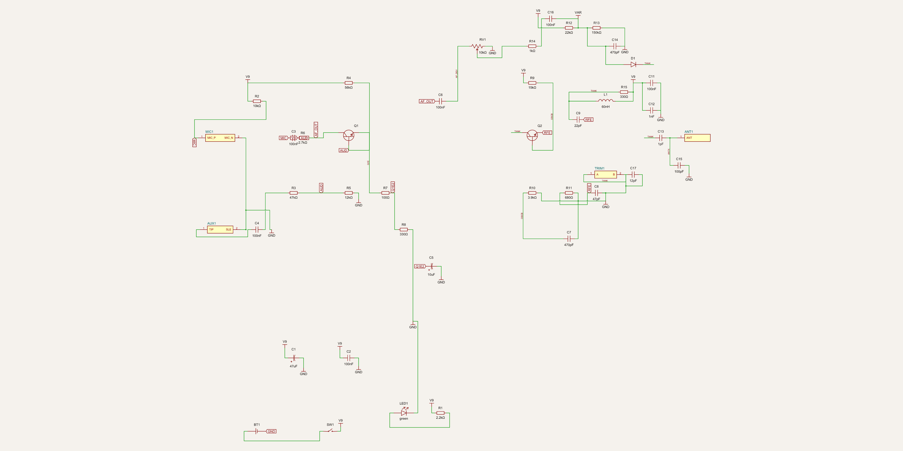
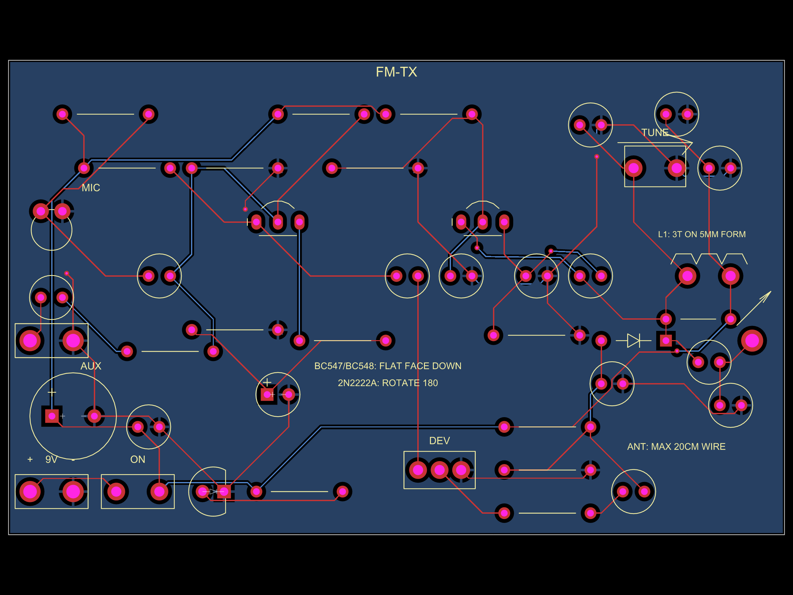
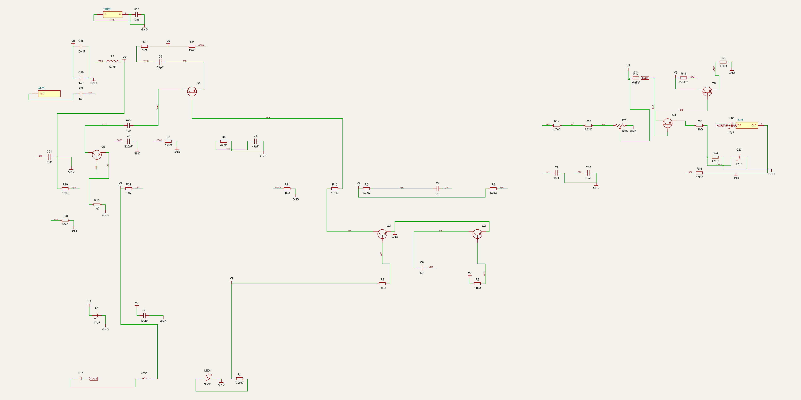
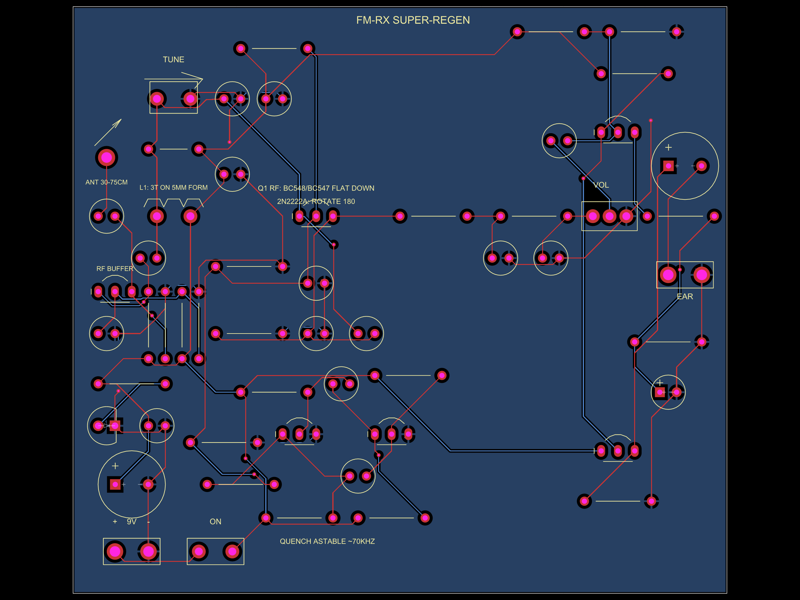

# Chapter 6 — Guided tour: FM Radio Lab (the FM pair)

> **What you need:** chapters 1–2, and chapter 5's tour helps (this tour
> reuses the three-move transistor read and the LC-tank idea without
> re-explaining them).
>
> **What you'll learn:** how **FM** (frequency modulation) is made and
> recovered with two transistors' worth of hardware, what a **varactor**
> is, why this receiver is *the same circuit* as the transmitter — and one
> of the strangest, most beautiful receiver architectures ever invented:
> the **super-regenerative detector**.

**The project in one paragraph.** The AM lab (chapter 5) stamped your voice
onto a radio wave by changing the wave's *amplitude*. FM changes the wave's
*frequency* instead — the number of wobbles per second — which is how the
FM band (88–108 MHz) you car-radio listens to works. The transmitter does
it with a diode whose capacitance follows your voice; the receiver undoes
it with an oscillator that is strangled 70,000 times a second. Both boards
share *the same oscillator core*, deliberately — comparing them
side-by-side is the whole lesson.

```
TRANSMITTER (fm-tx)                        RECEIVER (fm-rx)

mic/aux → preamp Q1 ─→ DEV knob ─┐         wire → RF buffer Q5 → ┌ detector Q1 ┐
                                 ↓                               │ = TX's osc  │→ audio
  varactor D1 across the tank of ┌───────────────────────────────┤ strangled by├→ filter
  the Colpitts oscillator Q2  ───┘  88-108 MHz radio wave   →→→  └ quench Q2+Q3┘→ volume
  (TUNE trimmer slides the band)                                 → amp Q4/Q6 → earphone
```

**Open the views while you read:**

```bash
cd fm-radio-lab && tsci dev transmitter/index.tsx   # or receiver/index.tsx
```

…or zoom the committed renders below, or paste `standalone/fm-tx-*.tsx` /
`fm-rx-*.tsx` into <https://snippets.tscircuit.com>.

---

## Part A — The transmitter (fm-tx)



Only two transistors — and one of them is the radio. Read left→right.

### A1. Power — `BT1`, `SW1`, `C1`, `C2`, `LED1`, `R1`

Same battery block as chapter 5's A1 (you now recognize it on sight), but
read the comment in the code: supply stability matters **twice as much
here**. At 100 MHz, a wobble on the supply *shifts the oscillator's
frequency* ("supply pushing"). `C1`/`C2` aren't just decoupling here — they
are frequency-stability parts.

### A2. Two inputs — `MIC1` (+`R2`, `C3`) and `AUX1` (+`C4`, `R3`)

Same electret recipe as chapter 5, plus an **AUX** alternative: two pads
for a 3.5 mm jack. `C4` (100 nF) couples, `R3` (47 kΩ) *tames* a line-level
signal (phone, tone generator) down to mic scale. A **known tone** from AUX
makes bring-up much easier — the tutorial uses it as the standard
debugging signal, because "is it working?" is easier to answer with a
steady tone than with your voice.

### A3. Audio preamplifier — `Q1`

Common-emitter stage, the three-move read: `R4`/`R5` (56 k/12 k) bias the
base at ~1.6 V; `R7`+`R8` (100 Ω + 330 Ω) set ~2 mA, with `C5` bypassing
only `R8` (gain-boosting); load `R6` 2.7 kΩ. Gain ≈ `R6/(R7+r_e)` ≈
**18×** — enough to swing the varactor (A5) usefully. Compare with the AM
lab's 140×: different jobs, different gains; the *structure* is the same
and now you can read both.

### A4. The VHF oscillator — `Q2`, `L1`, `TRIM1`, `C8`, `C9`

The heart: a common-base **Colpitts at ~100 MHz** — the same topology as
the AM lab's oscillator, scaled up 100× in frequency:

* `R9`/`R10` (15 k / 3.9 k) hold the base at ~1.9 V; `C7` (470 pF) grounds
  the base at RF (≈3 Ω at 100 MHz — that's what makes it
  "common-base at RF").
* `R11` (680 Ω) sets ~1.7 mA — enough loop gain to start with the loaded
  tank, for either transistor type the BOM allows.
* `C9` 22 pF / `C8` 47 pF are the **feedback divider** (emitter at the
  midpoint — same Colpitts trick, smaller picofarads).
* `L1` is **a coil you wind yourself**: 3 turns of wire on a 5 mm form,
  ≈56 nH. It's drawn as a coil symbol and *labelled on the silkscreen*
  (`L1: 3T ON 5MM FORM`). The tank capacitance is `C9`+`C8` in series
  (~15 pF) + transistor strays + the varactor (next) + `C17` (12 pF
  padder) + `TRIM1` (5–30 pF, the **TUNE** screwdriver knob):

```
f = 1/(2π√(L·C))  →  ≈81 … 104 MHz across TRIM1's range
```

Two numbers on this board were *chosen for the law*: `C17` exists because
without it the trimmer reached 115–120 MHz — the **aviation band**
(108–137 MHz), where transmitting is dangerous as well as illegal. And
`R15` (330 Ω) deliberately **damps** the tank: an undamped oscillator
grows until the transistor slams into saturation (~9 V of swing on the
coil), and a coil carrying that is itself a small loop antenna radiating
far above the licence-free limit. With `R15`, swing is pinned at
0.55–0.85 V whatever the coil's Q — the coil's own radiation drops ~20 dB.
`C11`/`C12` give the coil's supply end a solid RF ground; they are part of
the resonator, not decoration.

### A5. The varactor — `D1`, `R12`, `R13`, `R14`, `RV1`, `C6`, `C14`, `C16` — *where FM is born*

The trick that makes this an FM transmitter. A reverse-biased diode has a
depletion layer that acts as a capacitor — and the capacitance **shrinks**
as you increase the reverse voltage. Used this way, the diode is called a
**varactor**. `D1` (an ordinary 1N4148 pressed into service) sits *across
the tank*:

* cathode on net `TANK` (≈9 V DC, arriving through the coil),
* anode on net `VAR`, held at ≈7.85 V by `R12` 22 k / `R13` 150 k —
  so ~1.15 V of reverse bias, safely more than the ≤0.8 V RF peak: the
  diode never actually conducts. `C14` (470 pF) is `VAR`'s RF ground.

Now feed your voice onto that bias: `Q1`'s output → `C6` → the **DEV**
trimmer `RV1` (a volume-pot footprint used as a screwdriver-set deviation
control) → `R14` → `C16` (DC block) → net `VAR`. Voice wiggles the reverse
voltage → the varactor's capacitance wiggles → the tank's resonance
wiggles → **the carrier's frequency wiggles with your voice**. That is FM,
made with two dozen through-hole parts. Simulated sensitivity:
0.13–0.59 kHz per mV in-band; broadcast FM deviates up to ±75 kHz, and
FCC §15.239 (US) confines you to a 200 kHz band — hence "turn DEV up only
until speech is loud and clean".

*Why a diode and not "modulate the transistor", the classic FM-bug way?*
The code comment tells you: simulated with real transistor models, the
transistor's own junction capacitance gives 0.04–5 kHz/mV of erratic
sensitivity — *even changing sign* with transistor type and tuning. A
dedicated varactor is predictable. (A real varactor like a BB910 can
replace `D1` for more deviation per mV.)

### A6. The antenna — `C13`, `C15`, `ANT1`

FM's legal limit (US §15.239) is brutal: 250 µV/m at 3 m — about 19 nW of
radiated power. The tank's ~0.6 V must be watered down ~100:1 before it
meets a wire. `C13` (1 pF) and `C15` (100 pF) form a **capacitive voltage
divider**: the `ANT` pad sees ~1% of the tank voltage, and the wire is
kept ≤20 cm (printed on the board: `ANT: MAX 20CM WIRE`). Simulated total
radiation stays ≥14 dB under the limit — a few metres of range, which is
the point: it's a lab, not a pirate station.

### A7. Reading the PCB



Left→right: battery/switch, `MIC` and `AUX` pads stacked on the left edge,
`Q1` with its bias cluster, then `Q2` and — packed tight around the top
right — the whole **RF island**: `L1`'s coil circle, the `TUNE` trimmer
box, the padder `C17`, the damper `R15`, the varactor `D1` with its bias
network. That tightness is not aesthetic: at 100 MHz every millimetre of
trace is inductance, so everything that resonates together *sits*
together. The `DEV` trimmer and its audio feed sit lower, deliberately off
the island. Blue bottom layer: the ground pour that makes "RF ground"
real.

---

## Part B — The receiver (fm-rx): a super-regenerative set



Six transistors, and the architecture is the star:

```
wire → RF buffer Q5 → ┌ detector Q1 ─┐→ 2×RC audio filter → volume →
                      │ THE TX CORE  │                        Q4 amp → Q6 → earphone
                      └ strangled by ┘
                        quench astable (Q2+Q3, ~70 kHz)
```

### B1. The big idea: the receiver IS the transmitter

Look at `Q1` on this schematic next to `Q2` on the transmitter's. Same
common-base Colpitts. Same coil (`L1`, 3 turns on 5 mm), same `TRIM1`
(5–30 pF) + `C17` (12 pF padder — same aviation-band story), same 22 p /
47 p feedback pair (`C6`/`C5` here), same 15 k / 3.9 k base divider
(`R2`/`R3`). An oscillator *radiates a little*; a receiver that contains
an oscillator *is listening with an oscillator* — tune its tank with the
same trimmer and the two windows slide across the band together.

The difference is **who feeds the base**. On the TX, the divider sets a
steady bias and the oscillator runs forever. Here, two extra resistors
join the base node (`OSCB`): `R10` (4.7 k, from the quench oscillator) and
`R11` (1 k to ground). The quench oscillator *gates* that bias ~70,000
times a second:

* **astable LOW** → base ≈0.39 V → `Q1` cut off. The burst dies. SILENCE.
* **astable ramping up** → base climbs toward ≈1.07 V → the loop gain
  crosses 1 and a burst **ignites**, seeded by whatever rides the tank:
  thermal noise (the loud HISS you hear between stations) or an incoming
  carrier (QUIETING + audio). A µV seed becomes a ~1 V burst in ~1 µs —
  amplification *in time*, the 10⁴–10⁶ gain of **super-regeneration**.
* …then the astable drops, the burst is strangled, and it all repeats at
  an ultrasonic ~70 kHz. You hear none of the 70 kHz — only the audio
  riding on the burst envelope.

### B2. Why an external quench? (the design lesson)

Armstrong's original super-regens (1922!) *self*-quenched: the tube's own
rectified grid current slowly strangled it. The code header explains why a
transistor **cannot** copy that trick: its rectified base current pushes
the base *up* (anti-quenching), and a quench capacitor on the emitter side
would short out the Colpitts feedback divider at RF. So — like every
production super-regen since the 1940s — the strangling is done by a
**separate oscillator**: `Q2`+`Q3`, a textbook **astable multivibrator**
(two transistors cross-coupled by `C7`/`C8`, timing `≈0.693·(R9·C8 +
R8·C7)` unloaded ≈20 µs, loaded by `R10`/`R11` to ≈14 µs → ~70 kHz).
`Q2`'s collector — snap down, long low, smooth exponential rise — is
exactly the waveform the super-regen literature prescribes.

### B3. The RF buffer — `Q5` (and why it's there)

A super-regen detector *is* an oscillator, and oscillators radiate. The
classic hobby circuit wires the antenna straight onto the tank; simulated,
that re-radiated ~−13 dBm — 38 dB above the legal limit for receivers
(FCC §15.109), i.e. a receiver that jams the FM radios nearby. `Q5`, a
common-base **buffer**, breaks that: the antenna drives its *emitter*
(through `C3`), its base is RF-grounded (`C21`), and its collector feeds
the tank through `C22` — **1 pF**, a whisper of coupling. Signal flows
antenna→tank easily; the tank's bursts flow back out only through the
transistor's tiny internal capacitance (~60 dB of isolation). `R22` (1 k)
damps the tank exactly like the TX's `R15` — same radiation math, same
fix. This block is a beautiful example of *reading a schematic and finding
a regulation wearing a resistor's clothes*.

### B4. Recovering the audio — slope detection + the filter

**FM trick:** a super-regen is natively an AM detector. To hear FM, you
tune the `TUNE` trimmer slightly *off* the station: on the tank's response
**slope**, the station's ±75 kHz frequency wobble becomes an amplitude
wobble, every burst's seed wobbles with it, and the burst envelope carries
the audio. (Tune a hair high or a hair low — both work, opposite
polarity.)

**THE SILENCE IS THE SIGNAL:** sweep `TUNE` across a live carrier and the
loud hiss *collapses* into the station — the carrier seeds every
regrowth, and there's nothing left to hiss about. That quieting "thump" is
the sound of radio-wave capture, and the tutorial makes a whole experiment
of it.

The detected audio rides `Q1`'s emitter (net `RFE`) buried under 70 kHz
quench residue. Two RC poles — `R12`+`C9`, `R13`+`C10` (4.7 k + 10 nF
each) — knock the quench down ~47 dB while speech-band audio passes into
the volume pot `RV1`. Then `Q4` (common-emitter, gain ≈24×, with `R16`
120 Ω left unbypassed for linearity) and `Q6` (emitter follower, ~25 Ω
output) drive ordinary 32 Ω earbuds through `C12`. Why a follower? `Q4`'s
3.3 kΩ collector can't drive 32 Ω directly (gain would collapse to ~0.2×);
the follower transforms the impedance. Same trick every audio output stage
in the world uses, in miniature.

### B5. Reading the PCB



*The receiver board is the taller one (99×89 mm): RF island top-left,
detector + quench in the middle, audio chain on the right.*

Top-left: `ANT 30-75CM` pad and, right below it, `Q5`'s vertical stack
(`RF BUFFER` on the silkscreen) feeding the coil `L1` + `TUNE` trimmer —
the RF island, compact for the same VHF reasons as the transmitter's.
Centre: `Q1` the detector, and below it the two-transistor quench
astable (`QUENCH ASTABLE ~70KHZ` printed on the board!). Right half: the
audio filter resistors/caps in a neat chain, `VOL`, then `Q4`/`Q6` down to
the `EAR` pads. Blue pour underneath. Notice the board is *taller* than
the TX (99×89 mm) — the audio end needed room, and keeping it physically
away from the RF island is itself a design decision (audio gain amplifying
leaked RF = howling).

---

## Part C — Using the pair

1. Transmitter: set `TUNE` mid-band, feed a tone into `AUX`, `DEV` low.
2. Receiver: volume DOWN (the hiss is loud), sweep `TUNE` until the hiss
   collapses onto your tone. Nudge `TUNE` off-centre for slope detection.
   Walk the transmitter's `TUNE` and follow it with the receiver — two
   windows sliding across the band, in lockstep because they are the same
   circuit.
3. The tutorial's experiments: quieting vs `DEV`, hearing broadcast FM
   stations (carefully, at the band edges), the "why does the hiss die"
   demonstration.

**Build it for real:** through-hole on a 0.1" grid — but at 100 MHz, *lead
length is a component*: the tutorial's VHF soldering pages (short leads,
coil winding, which pads to keep tight) are the difference between
"works" and "mystifying". BOM + bring-up ritual in
`fm-radio-lab/docs/fm-radio-lab-tutorial.pdf` (errata in the README);
`npm run math` / `npm run sim` re-derive every number above.

---

## Check yourself

1. In one sentence each: how does the AM-TX put voice on a carrier, and
   how does the FM-TX?
2. What is a varactor, and why does this design use one instead of
   modulating the transistor itself?
3. Why does the receiver re-radiate less than the classic hobby circuit?
4. What is "quenching" and roughly how often does it happen? Can you hear
   it?
5. Why does the hiss collapse when you tune to a live station?

<details>
<summary>Answers</summary>

1. AM: the final amplifier's *supply rail* (`VMD`) wiggles with the voice,
   so the carrier's amplitude follows it. FM: the voice wiggles a varactor's
   capacitance inside the tank, so the carrier's *frequency* follows it.
2. A reverse-biased diode whose capacitance falls as reverse voltage
   rises. Predictable, tuneable sensitivity (0.13–0.59 kHz/mV) vs the
   transistor-junction method's erratic 0.04–5 kHz/mV that even changes
   sign.
3. The RF buffer `Q5` + 1 pF feed isolate antenna from tank (~60 dB), and
   `R22` damps the tank's burst amplitude — both cut re-radiation ≥7 dB
   under the §15.109 limit where the classic circuit was ~38 dB over.
4. The astable `Q2`/`Q3` killing and re-igniting the detector's
   oscillation — ~70,000×/s. No: it's ultrasonic; only the audio on the
   burst envelope is audible.
5. A carrier present seeds every regrowth with itself instead of random
   noise — nothing left to hiss about ("quieting").
</details>

---

**Next:** [Chapter 7 — the μNode32U4 dev board →](./07-tour-unode-32u4.md) ·
[Course home](./README.md)
