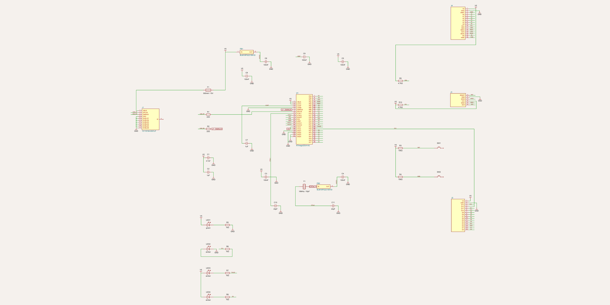
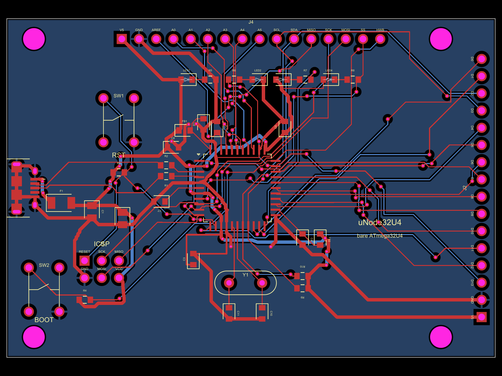

# Chapter 7 — Guided tour: μNode32U4 (a dev board from a bare chip)

> **What you need:** chapters 1–2 (chapter 5's tour helps for the reading
> rhythm).
>
> **What you'll learn:** how a microcontroller *board* is built around a
> bare chip — the four "life-support systems" every MCU needs (clean power,
> a clock, a reset, a programming port), what USB asks of a board, and why
> this project is rated *intermediate* (it's the repo's surface-mount
> board).

**The project in one paragraph.** An Arduino Leonardo is a printed circuit
board whose interesting occupant is one chip — the ATmega32U4 — plus a
supporting cast. This project builds that board from first principles:
one bare TQFP-44 ATmega32U4 and ~35 parts, no dev-board module anywhere.
USB socket, crystal, reset/boot buttons, programming header, four LEDs,
I²C pull-ups, and every GPIO on labelled 2.54 mm headers with
Leonardo-compatible names. Flash the Caterina bootloader, pick "Arduino
Leonardo" in the IDE, and it just works.

```
                 ┌────────────── the chip: ATmega32U4 (U1) ──────────────┐
 USB J1 ──► fuse ─┼─ 5V ─► 11 decoupling caps + 2 ferrite beads (power)  │
 (D+/D− via        │                                                      │
  22Ω each) ──────┼─ data                                                │
 16 MHz Y1 ───────┼─ clock (2×22 pF load caps)                           │
 SW1/SW2 + 10k ───┼─ reset & bootloader entry                            │
 J3 ICSP ─────────┼─ programming                                          │
 J2/J4 headers ◄──┴─ all I/O, with names you know (D0-D13, A0-A5, SDA…)  │
```

**Open the views while you read:**

```bash
cd unode-32u4 && tsci dev      # or: tsci dev index.tsx
```

…or zoom the renders below, or paste `standalone/unode32u4-playground.tsx`
into <https://snippets.tscircuit.com>. The full sub-circuit-by-sub-circuit
story with all the worked math is `unode-32u4/unode32u4-tutorial.pdf`.

---

## 7.1 First look at the schematic



First thing to notice: **the biggest symbol on the page is a box** — the
ATmega32U4, `U1`, with dozens of *named pins* (`VBUS`, `DPLUS`, `XTAL1`,
`RESET`, `PD5`, `PF7`…). Chapter 1 told you a chip box is a compression of
its internals; here it's also the *spine* of the schematic — every other
part hangs off one of its pins, and the pin names tell you which
sub-circuit each belongs to. That's exactly how the file's own banner
comments organize the code: USB front-end → power integrity → clock →
reset/boot → ICSP → indicators → I²C → breakouts. Read the schematic in
that order and the board assembles itself in your head.

Second thing: unlike the radio labs, almost everything here is
**surface-mount** (`0603`/`0805` footprints on the PCB view) and the
"signals" are mostly not analog waves but *conditions*: is power clean? is
the clock running? is reset released? The reading skill shifts from
"follow the signal" to "check every need of the chip."

## 7.2 USB front-end — `J1`, `F1`, `R1`, `R2`

USB enters at `J1` (micro-B receptacle, deliberately at the board edge —
see §7.9). Three protections before the bus meets the chip:

* **`F1` — a PTC resettable fuse** (500 mA hold). If anything downstream
  short-circuits, the fuse goes high-resistance instead of letting the
  wire melt; remove the fault, it cools, it's a fuse again. Its output
  becomes the board's 5 V rail, net `V5`.
* **`R1`/`R2` — 22 Ω in series with D+ and D−.** Not decoration: the
  ATmega32U4 datasheet *mandates* them — they damp reflections on the
  12 Mbit/s pair and limit inrush through the chip's USB pads. A great
  example of "the schematic encodes the datasheet."
* **The shield** (four through-legs + SMD tabs) is tied to `GND` —
  shielding and mechanical strength.

Note on the schematic how the two *sides* of `R1` carry **different net
labels** (`USB_DP` on the connector side, unnamed on the chip side): a
series resistor is two nets, not one — a detail beginners trip on when
debugging.

## 7.3 Power integrity — eleven capacitors and two ferrite beads

The densest block on the schematic, and the one the tutorial spends most
time on, because a 32U4 board's #1 bring-up killer is sloppy decoupling.
The chip has *separate supply pins for separate jobs*, and each gets its
own local capacitor:

| Pin(s) | What it powers | Decoupling |
|---|---|---|
| `VCC1` (14), `VCC2` (34) | digital core | `C3`, `C5` — 100 nF each |
| `UVCC` (2) | the USB pad supply | `C8` — 100 nF |
| `UCAP` (6) | the chip's *internal* 3.3 V regulator output | `C7` — exactly 1 µF (datasheet) |
| `AVCC1` (24), `AVCC2` (44) | analog/ADC supplies | 100 nF each (`C4`, `C6`), **each fed through its own ferrite bead** (`FB2`, `FB1`) from V5 |
| `AREF` (42) | the ADC's reference | `C9` — 100 nF |
| bulk at the entry | the whole rail | `C1` 4.7 µF + `C2` 1 µF |

Why a ferrite bead on the analog supplies? A bead is a resistor *for high
frequencies only*: digital noise on V5 gets eaten before it reaches the
ADC, while DC passes freely. The datasheet's app-note figure asks for the
same filter on *both* analog pins — the code comment walks through why
tying them together would short out `FB1`'s filtering.

And why so *few* microfarads in total (~6.4 µF)? Because USB 2.0 caps a
device at 10 µF on VBUS at plug-in (a bigger cap looks like a short to
the port). Constraint from the standard, visible in a capacitor value —
schematics are full of law, if you can read it.

**Read this block on the PCB** (below): each little 0603 cap sits hugging
the pin it serves, sometimes rotated 90° or tucked under the chip's corner
— every position is a comment about its escape route. Placement *is* part
of the specification for decoupling: close = effective.

## 7.4 The clock — `Y1`, `C10`, `C11`

A **16 MHz crystal** between `XTAL1`/`XTAL2`, with two 22 pF capacitors to
ground. The arithmetic in one line: a crystal specified for
`CL = 15 pF` "load capacitance" wants
`C = 2·(CL − C_stray) ≈ 2·(15−4) = 22 pF` from each leg to ground — the
full derivation is in the tutorial PDF.

The layout lesson (and the code comment is emphatic): **crystal traces
must be short** — tscircuit's crystal DRC enforces ≤10 mm and no vias;
this board keeps every segment under 3 mm. At 16 MHz, long traces are
antennas and stray capacitance; the caps sit *between* chip and crystal,
one under each XTAL pad — the classic Atmel app-note arrangement. A
crystal has no polarity, so the code even cross-assigns its pins
(`pin1→XTAL2`, `pin2→XTAL1`) purely to avoid a crossing trace.

## 7.5 Reset & bootloader entry — `R3`, `SW1`, `R4`, `SW2`

Two identical little circuits — a **10 kΩ pull-up to 5 V** (idle = logic
HIGH) and a **push-button to ground** (press = LOW):

* `R3`+`SW1` on `RESET` (active-**low** — LOW means reset). Hold SW1 while
  applying power or releasing: the chip restarts.
* `R4`+`SW2` on `HWB` (pin `PE2`) — "hardware boot". The story in the
  comment is worth reading: a factory-fresh ATmega32U4 ships with a USB
  (DFU) bootloader and the HWBE fuse programmed, so **SW2+SW1 reach the
  bootloader with no external programmer at all**. After you burn the
  Leonardo-style fuses, the chip enters its (Caterina) bootloader on every
  reset anyway, and `SW2` becomes a plain user button on `PE2`.

The pull-up pattern (a resistor holding a pin at a defined level when
nothing drives it) is one of the most common sub-circuits in electronics —
you'll find it again on the lamp's MOSFET gates (chapter 8) and the
lighter's power switch (chapter 9), where it plays the *safety* role of
"off by default."

## 7.6 ICSP — `J3`, the 2×3 programming header

The standard AVR ISP header: `MISO VCC / SCK MOSI / RESET GND`. What makes
this block interesting is a **layout trap** the code documents: with the
header rotated 90° on the PCB, tscircuit numbers its six pads in a *ring*,
so the `pinLabels` array had to be arranged (not in reading order!) so the
*physical* grid comes out standard. Get it wrong and a keyed programmer
cable puts VCC where GND belongs. The project's `proof.mjs` (102
assertions against the datasheet) literally tests the physical arrangement
so it can never silently regress — verification culture, in one header.

## 7.7 Indicators and I²C

**Four LEDs** in a row, each with a 1 kΩ resistor (recipe #1, chapter 1) —
but read the *direction* of each on the schematic; two are wired
"backwards" on purpose:

* `LED1` PWR — green, V5→R→LED→GND, always on. Normal.
* `LED2` L — `PC7`→R→LED→GND, active-HIGH (Arduino pin 13's LED).
* `LED3` TX and `LED4` RX — **V5→LED→R→pin**: active-**LOW**, because the
  Arduino core's TXLED1/RXLED1 macros drive those pins LOW to light them.
  Same LED recipe, flipped wiring, and the schematic shows it if you look.

**I²C pull-ups** `R9`/`R10` (4.7 kΩ to V5 on `SDA`/`SCL`): the I²C bus
standard requires pull-ups so any sensor works out of the box; weak enough
not to disturb ordinary GPIO use of those header pins.

## 7.8 Breakout headers — `J2`, `J4`

Two 16-pin headers with silkscreened names matching **Arduino Leonardo**
tutorials: `J2` down the right edge carries `D0–D13` (+5V/GND); `J4`
across the top carries `A0–A5`, `SCL/SDA`, `MISO/SCK/MOSI/SS`, `HWB`,
`AREF`. On the schematic these read as a wall of net labels — and now you
know that each label is a promise that the header pin, the chip pin, and
anything else on that net are one point. The code comment flags the key
*placement* decision: running `J2` down the right edge lets the chip's
right-side ports escape straight out to it, instead of carving through the
fan-out — schematic readability and PCB routability, hand in hand.

## 7.9 Reading the PCB



* **Left edge:** the USB connector overhanging the board outline (so a
  plug's overmold can seat) — the footprint origin sits 2.75 mm inboard
  on purpose.
* **Centre:** the 44-pad QFP square, `U1`, pin 1 marked. Note the *fan-out*
  — the short traces bending out from under each chip edge to reach the
  rest of the board. Around it, like bodyguards, the decoupling caps
  (§7.3) and the crystal cluster directly below (§7.4).
* **Right edge:** breakout header `J2` with its silkscreened pin names;
  **top edge:** `J4`; top-left corner `RST`/`BOOT` buttons; the ICSP
  `J3` header below the chip.
* **Four 3.2 mm mounting holes** at the corners (unplated — pure
  mechanics).
* **Bottom layer:** the ground pour (blue) under everything — every GND
  pin's via drops straight into it.

This is the board to study for **what "professional" adds beyond
"works"**: decoupling discipline, placement-for-escape, edge-connector
geometry, a ground plane, and a DRC/proof gate on the whole thing.

## 7.10 Bring-up (the short version)

Full ritual in the tutorial: visual inspection → 5 V rail resistance check
(no dead short) → apply USB power (PWR LED lights, chip stays cold) →
either enter the factory DFU bootloader (`SW2`+`SW1`) or use an ISP
programmer on `J3` to flash the Caterina bootloader + fuses → select
"Arduino Leonardo" → blink. Each step exists because of a failure mode the
schematic can't prevent — assembly can. When you read *any* board's
bring-up section, you're reading a checklist of "ways this schematic
becomes a paperweight."

---

## Check yourself

1. Name the four "life-support" systems a bare microcontroller chip needs
   from its board.
2. Why exactly 22 pF on the crystal legs? Why not "about 20"?
3. What do `R1`/`R2` (22 Ω) do that the chip's own pins can't?
4. `LED3` (TX) is wired V5→LED→resistor→pin. What does that tell you about
   how the firmware lights it, compared to `LED2` (L)?
5. Why does `AVCC` get a ferrite bead when `VCC` doesn't?

<details>
<summary>Answers</summary>

1. Clean power (decoupling per pin), a clock (crystal + load caps), reset
   control (pull-up + button), and a programming port (ICSP/USB).
2. From the crystal's specified load capacitance: `C = 2·(CL − Cstray) =
   2·(15−4) ≈ 22 pF`. The value is part of keeping the crystal *on
   frequency*; it's a spec, not a guess.
3. They damp reflections and limit inrush on the 12 Mbit/s USB pair —
   the datasheet mandates them "as close as possible" to the chip.
4. `LED3` lights when the pin is driven LOW (active-low, matching the
   Arduino TX/RX LED macros); `LED2` lights when its pin is HIGH
   (active-high, like pin-13 LEDs on classic Arduinos).
5. `AVCC` feeds the ADC, which measures millivolts; the bead strips
   digital supply noise before it reaches the analog domain. `VCC`'s
   digital consumers don't care.
</details>

---

**Next:** [Chapter 8 — the Tri-Color Lamp →](./08-tour-tricolor-lamp.md) ·
[Course home](./README.md)
