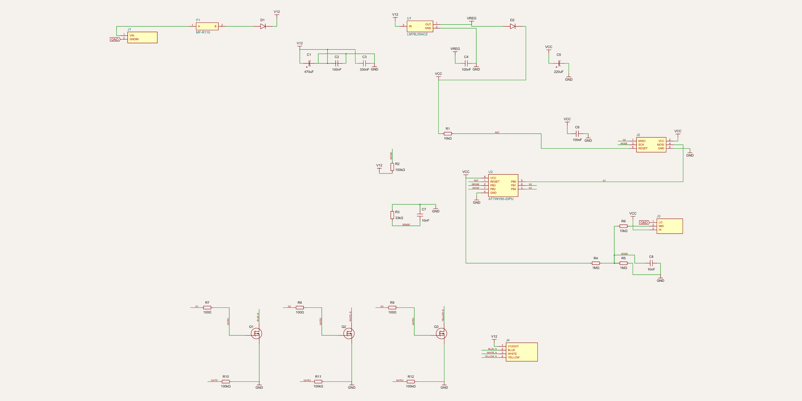
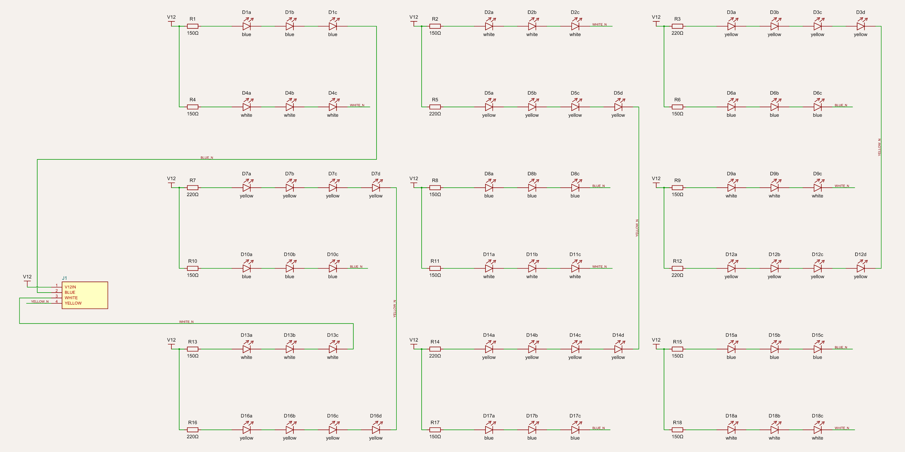
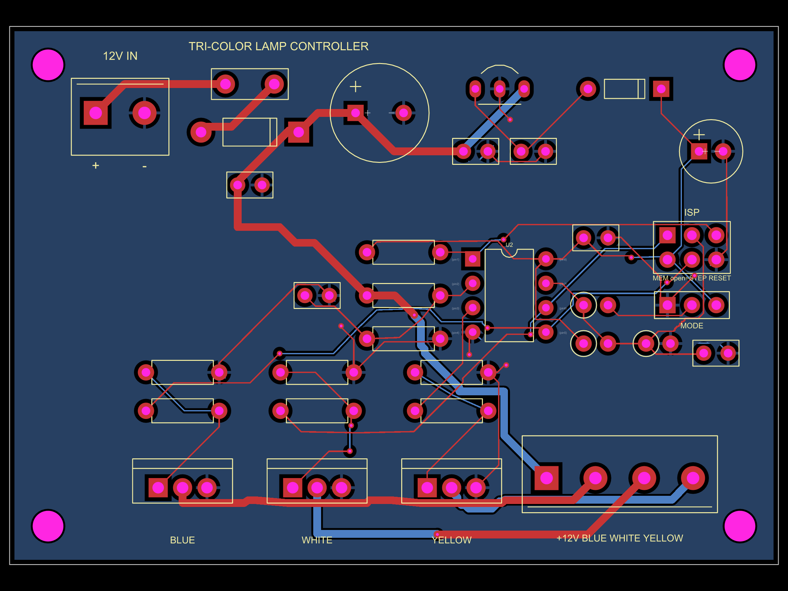
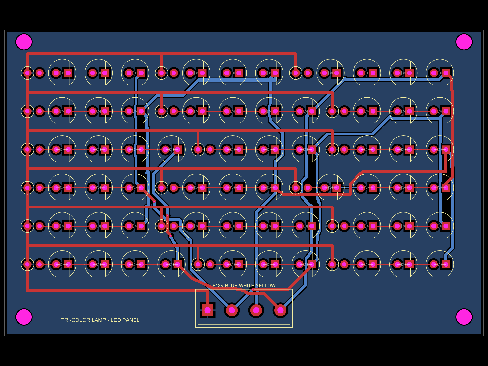

# Chapter 8 — Guided tour: the Tri-Color Lamp (two boards that talk by wire)

> **What you need:** chapters 1–2 (MOSFET symbol basics appear here for
> the first time — they're introduced below).
>
> **What you'll learn:** how a circuit can *notice the wall switch* without
> touching mains; how a microcontroller measures a voltage it can't
> directly touch (a divider again!); your first **MOSFET** as a switch;
> and how a project splits across two boards joined by a cable.

**The project in one paragraph.** Store-bought "3-colour" ceiling lamps
change colour each time you flip the wall switch — blue → white → yellow →
blue… This project rebuilds that behaviour *safely*: a certified 12 V
power supply does the dangerous mains part; a controller board watches
the 12 V, and when it sees the power go away and come back quickly, it
steps the colour; a LED panel board lights 60 LEDs in the chosen colour.
Everything on these boards is low voltage.

```
wall switch ─► certified 230/120V→12V supply ─► CONTROLLER ─► 4-wire cable ─► LED PANEL
   (the lamp never touches mains)                  │                            (60 LEDs, 3 colours)
                                                   ├─ ATtiny85 "brain" (U2)
                                                   ├─ watches 12 V (R2/R3 divider → ADC)
                                                   ├─ rides through power-offs on C5
                                                   └─ 3× MOSFET switches the colours
```

**The puzzle that makes it interesting:** the lamp must *react to the wall
switch* — but the switch lives upstream of the power supply, and all the
lamp ever sees is its 12 V output turning off and on. How do you sense a
switch you can't see? Watch the supply itself, and *keep running while
it's dead*.

**Open the views while you read:**

```bash
cd tricolor-lamp
tsci dev controller/index.tsx    # board 1
tsci dev led-panel/index.tsx     # board 2
```

…or zoom the renders below. The complete from-zero tutorial (water-pipe
analogies, moment-by-moment walk, firmware, parts, soldering, wiring to
the wall switch) is [`tricolor-lamp/README.md`](../tricolor-lamp/README.md)
— the deepest single document in the repo; this tour covers the
*reading-the-drawings* layer.

---

## 8.1 Reading the block map first

Both schematics are on the small side (controller ~30 parts, panel 78 —
but the panel is the *same little circuit* repeated 18 times, so it reads
fast). Read order for the controller:

```
12 V in → protection → 5 V for the brain → the brain (ATtiny85)
        → how it watches the 12 V → MODE jumper → three MOSFET channels → J4
```

## 8.2 The controller board



### §1 — 12 V in: `J1`, `F1`, `D1`, `C1`, `C2`

A screw terminal (`J1`: `VIN`, `GNDIN`), then three protections you now
have the vocabulary for:

* `F1` — **PTC resettable fuse** (1.1 A hold / 2.2 A trip): a short opens
  it; it recovers when cool. (Same part idea as μNode's `F1`, sized bigger
  for a lamp.)
* `D1` — **Schottky diode** (1N5819) in series: a one-way valve for
  reverse-polarity protection. Wire the supply backwards and nothing
  happens — the diode simply blocks, dropping only ~0.4 V in normal
  operation. (A Schottky is a diode with a low forward drop — the symbol
  is the same triangle-and-bar.)
* `C1` 470 µF + `C2` 100 nF — the decoupling pair, scaled up for a lamp:
  the big electrolytic also absorbs the LED panel's switching gulps.

After the valve, the rail gets a name: net `V12`.

### §2 — 5 V for the brain, and the "bucket": `U1`, `C3`, `C4`, `D2`, `C5`

`U1` (78L05) is a **linear regulator** — a chip box with three pins
(`IN`, `OUT`, `GND`) whose whole job is "give me a messy higher voltage,
get back a steady 5 V." `C3`/`C4` are its in/out decoupling (the
datasheet's recipe).

Then the clever bit. `D2` (1N4148) feeds the microcontroller's `VCC` from
the regulator — and `C5`, a **220 µF electrolytic "bucket,"** sits on the
chip side. Read the two-diode-trick carefully on the schematic: when the
12 V disappears (you flipped the wall switch), `D2` *blocks* — `C5` can't
discharge back into the dying regulator. It can only discharge *into the
chip*, which immediately falls asleep (~15 µA). The chip then runs off
the bucket for ≈30 s typically (≥5 s worst case, down to its 2.7 V
brown-out) — long enough to **time how long the power stayed off**.

That timing is the whole trick: the lamp can't see the switch, but it can
measure the length of the darkness.

### §3 — The brain: `U2` (ATtiny85) and how it watches the 12 V

`U2` is an 8-pin ATtiny85 (the same chip family as chapter 7's star, in
the small DIP package — sitting in a socket). Around it:

* `R1` 10 kΩ pull-up on `RESET` (μNode §7.5's pattern), `J2` the ISP
  header for programming, `C6` decoupling.
* **`PB3` ← net `SENSE`** — the 12 V, scaled down: `R2` 100 kΩ over
  `R3` 33 kΩ (divider, chapter 1 recipe #2!) turns 12 V into ≈2.97 V,
  which the chip's ADC (against `VCC`) reads as ≈670 of 1023. `C7`
  (10 nF) quiets the sample. *This is the schematic's key move: a pin
  that can only survive 5 V is taught to measure 12 V by two resistors.*
  The firmware calls "off" as soon as the reading falls 1/8 below normal
  — before the bucket even starts sagging.

### §4 — The MODE jumper: `J3`, `R4`–`R6`, `C8`

Three pads (`LO`, `MID`, `HI`) and a question: *what should a LONG
power-off do?* A quick flip always steps to the next colour; a long off
is configurable:

* no jumper → **STEP** (every power-on steps — the classic lamp),
* jumper on `LO` (ground) → **MEMORY** (comes back in the last colour),
* jumper on `HI` (VCC) → **RESET** (comes back blue).

How does one pin read three states? `R4`/`R5` (1 MΩ each) hold `PB2` at
half-rail when nothing is fitted; a fitted jumper yanks it to ground or
VCC through `R6` (10 kΩ, which also protects the programmer's SCK line
that shares the net). The ADC just checks which third of its range the
voltage sits in — *one analog pin, three settings*. `C8` (10 nF) gives
the ADC a calm source.

### §5 — The three colour taps: `Q1`–`Q3` + `R7`–`R12`, and your first MOSFETs

Meet the fourth semiconductor family in this course. A **MOSFET**
(metal-oxide-semiconductor field-effect transistor) is a voltage-operated
switch: voltage on the **gate** (a capacitor plate, essentially zero
current!) connects **drain** and **source**. Where a BJT was a foot-pedal
(current controls current), a MOSFET is a hand-lever (voltage controls
the connection) — and it switches *power* loads beautifully.

`Q1`/`Q2`/`Q3` are **IRLZ44N logic-level MOSFETs** in the TO-220 package
(the schematic's three-legged power parts; on the PCB they're the big
outlines with the metal tab). Each one switches one colour **on the
negative side** (low-side switching):

```
+12 V (always) ──► LED strings ──► colour wire ──► MOSFET drain
                                                     MOSFET source ──► GND
   chip pin ──► R (100 Ω) ──► MOSFET gate          ← drive HIGH = colour ON
                    R (100 kΩ) gate→GND            ← default = OFF
```

Two support parts per gate, both safety stories you've met before:

* `R7`–`R9` (100 Ω) in series — softens the gate's switching edges.
* `R10`–`R12` (100 kΩ) pull-downs — gates held LOW whenever the chip is
  in reset, being programmed, or unpowered. **The LEDs' safe default is
  OFF** — the same "off by default" discipline as the arc-lighter's power
  switch (chapter 9).

Why switch the *bottom* of the LEDs instead of the top? Ground-referenced
switching lets the chip's 0/5 V gate drive do the job directly (no extra
circuitry to translate), keeps the MOSFET's source grounded, and matches
how 12 V "RGB" LED strips are wired — common **anode** (+ side shared),
switched **cathodes**. `J4` (screw terminal: `+12V`, `BLUE`, `WHITE`,
`YELLOW`) carries this to the panel.

## 8.3 The LED panel board



78 parts — but look closely: it is **one 6-part pattern repeated 18
times**, a resistor + a chain of LEDs:

```
+12 V ──[ 150 Ω ]──►|──►|──►|── net BLUE_N     (a "string": 3 blue/white LEDs)
                     LED  LED  LED
```

*Why strings and resistors?* An LED wants a fixed forward voltage (~3.1 V
blue/white, ~2.1 V yellow) and then its current runs away — you never
feed one directly from a supply. Three in series *use* most of the 12 V
doing light; the resistor absorbs the remainder and sets the current:
`I = (11.6 − 3×3.1)/150 ≈ 15 mA` (11.6 V because the controller's
protection diode eats ~0.4 V). Yellow strings take 4 LEDs + 220 Ω
(`≈16 mA`) for the same current at yellow's lower forward voltage. Six
strings per colour in parallel give brightness, and each string having
its *own* resistor makes them share fairly.

On the schematic you'll see the strings drawn in tidy columns with net
labels `BLUE_N`, `WHITE_N`, `YELLOW_N` — the labels *are* the colour
buses, heading for `J1` (`+12V`, `BLUE`, `WHITE`, `YELLOW`), the pin-for-pin
mirror of the controller's `J4`. **Two boards, one cable, four nets.**

*(A code-reading aside: this board's `index.tsx` builds its 78 parts in a
loop over a layout table — the nicest small example in the repo of
"generate the repetitive parts, hand-place the special ones." After
chapter 4 you can read it line by line.)*

## 8.4 Reading the two PCBs



**Controller (80×56 mm):** screw terminals at opposite ends — 12 V in at
the top-left (`+`/`−` silkscreen), the four-wire colour bus out at the
bottom-right. Top edge: the regulator, the bucket `C5` (big round
outline), the brain `U2` in its socket. Centre: the MODE/ISP headers. The
three TO-220 MOSFETs stand along the bottom in a row — `BLUE`, `WHITE`,
`YELLOW` printed under each — with their fat 0.8 mm drain traces running
to `J4`. Note which traces are thick (colour channels, 1 A total) and
which are thin (gates, sense — milliamps).



**Panel (100×64 mm):** six rows of LEDs, each row starting with a
different colour (`B W Y / W Y B / Y B W …`) so each colour spreads
evenly across the panel. The standing resistors (drawn upright) begin
each string. And the layer trick worth noticing: **the bottom-layer pour
here is +12 V, not ground** — one solid sheet feeding all 18 string-tops;
the colour returns are ordinary traces. A pour is just "a net, spread
out" (chapter 2 §2.7); nothing says the net must be GND.

## 8.5 The moment-by-moment story (condensed)

You flip the wall switch OFF: the 12 V supply holds on a moment, then
sags. The brain's ADC sees `SENSE` fall 1/8 below normal → it stops
driving gates (colours off), saves the current colour to a *wear-levelled
EEPROM journal*, and sleeps on the bucket, counting. You flip ON:

* power back < 3 s after the off → **quick flip** → next colour;
* off longer (or bucket empty) → the **MODE jumper** decides:
  STEP / MEMORY / RESET.

The firmware then fades the new colour in over 0.3 s (software PWM,
~1300 blinks/s — too fast to see) and holds the MOSFET fully on. The
README's §1 and §6 tell this story with full warmth — read them next.

**Verification worth admiring:** this project's `npm run verify` audits
*both boards plus the cable between them* as one system, `npm run math`
runs 47 worst-case checks (bucket hold-up time, divider tolerances, LED
currents, MOSFET dissipation…), and `npm run test:firmware` runs the real
firmware against a model of the lamp in 15 switch-flip scenarios — plus
12 deliberately planted bugs that the test suite must catch.

---

## Check yourself

1. The lamp can't see the wall switch. Describe, in three sentences, how
   it knows you flipped it.
2. What are `R2`/`R3` for, and what would break without `C7`?
3. Why do the LED strings switch on their *cathode* side?
4. What do `R10`–`R12` (100 kΩ, gate→GND) guarantee?
5. On the panel board, why does each string get its own resistor instead
   of one shared resistor per colour?

<details>
<summary>Answers</summary>

1. The supply's 12 V output sags when switched off; the ADC (via `R2`/`R3`)
   notices; the chip — kept alive by bucket `C5` behind diode `D2` —
   times the outage; the length of the outage decides the action.
2. They scale 12 V down to ≈3 V (ADC-safe). Without `C7`, supply
   switching noise would masquerade as flips and the firmware would
   misread them.
3. Low-side switching keeps the MOSFET's source grounded, so the chip's
   0/5 V gate drive works directly — and it matches common-anode LED
   strip wiring.
4. Gates held LOW during reset/programming/unpowered: the safe default is
   LEDs OFF, always.
5. Parallel LED strings don't share current fairly by themselves (slight
   forward-voltage differences make one string hog current); per-string
   resistors force the sharing.
</details>

---

**Next:** [Chapter 9 — the Arc Lighter →](./09-tour-arc-lighter.md) ·
[Course home](./README.md)
